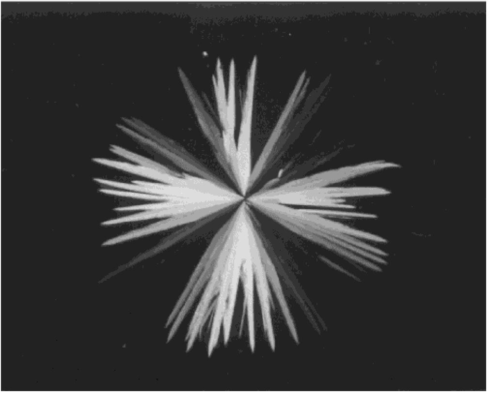
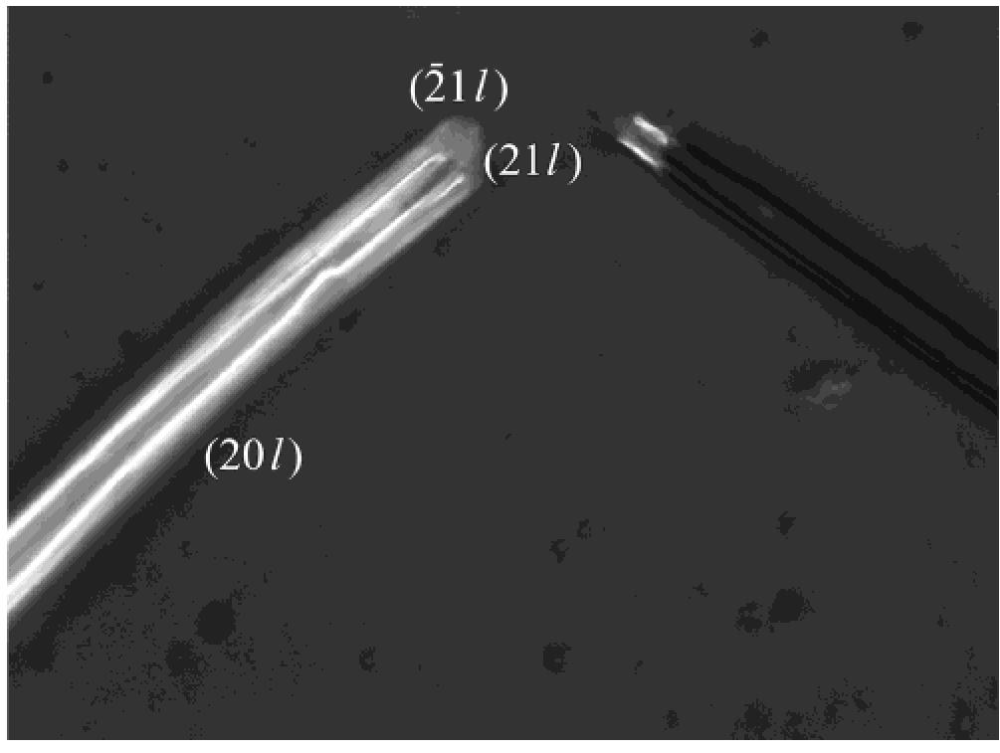
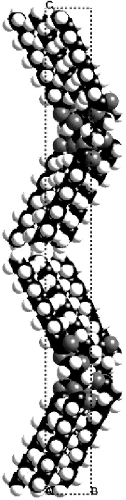
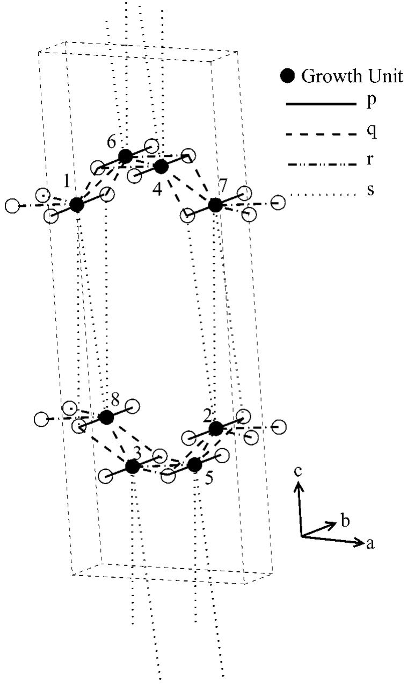
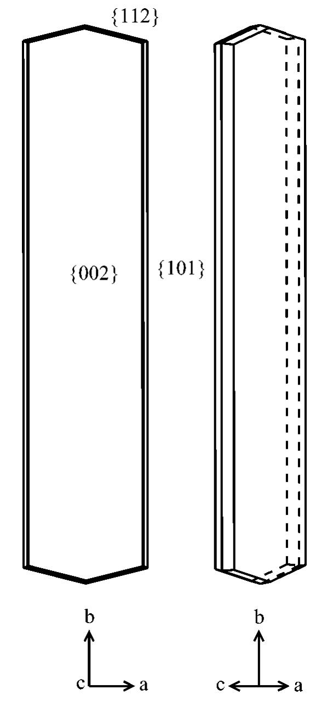
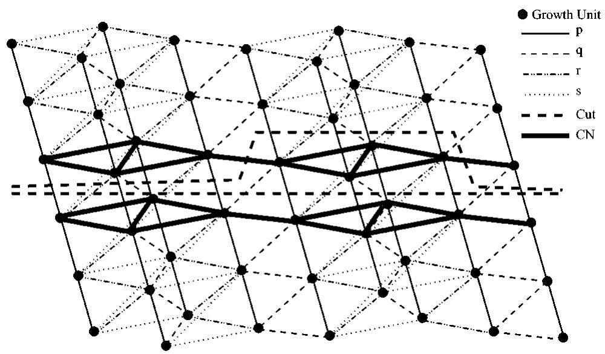
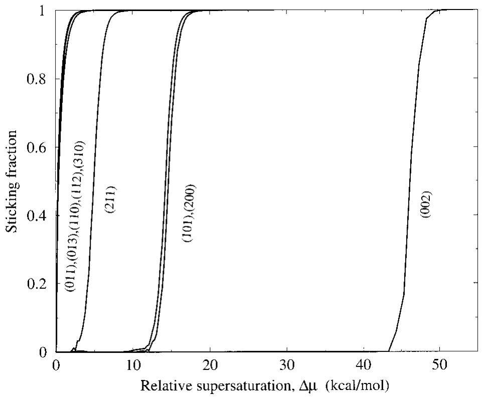

<PAGE>
Explanation for the Needle Morphology of Crystals Applied to a  \( \beta' \)  Triacylglycerol
S. X. M. Boerrigter, F. F. A. Hollander, J. van de Streek, \( ^{1} \)  P. Bennema, and H. Meekes \( ^{2} \)
RIM laboratory of Solid State Chemistry, Faculty of Science, University of Nijmegen, Toernooiveld 1, 6525 ED Nijmegen, The Netherlands
Received October 1, 2001; Revised Manuscript Received November 5, 2001
ABSTRACT: We describe a method that explains the morphology of needle-shaped crystals by analyzing the growth mechanisms for the various crystal faces, the relevant parameter being the edge free energy of a two-dimensional nucleus on a surface. As an example, the crystal morphology of a  \( \beta' \)  triacylglycerol is chosen. The results are compared with Monte Carlo simulations.
Understanding the morphology of crystals is, apart from a scientific challenge, important in practical applications. Crystallization is one of the key solid–liquid separation techniques. A wide spread problem in industry is processing needle-shaped crystals. The needle morphology can give rise to problems in handling and product quality issues such as blinding filters and solvent. Thus, needle shapes are usually not desired. An understanding of the morphology of crystals opens ways to avoid such undesired behavior. The morphology is sometimes altered by adding well-chosen chemicals as habit modifiers. An intelligent choice for such modifiers cannot be made until the growth mechanism is understood. Crystal morphology prediction methods almost invariably rely on the assumption that the growth rate of a crystal face is proportional to its attachment energy. \( ^{1} \)  This approach does not take the growth mechanism into account. Here we describe a method that explains the morphology of needle-shaped crystals by analyzing the growth mechanisms for the various crystal faces, the relevant parameter being the edge free energy of a two-dimensional nucleus on a surface. The results are compared with Monte Carlo simulations.
As an example for needle habits, crystals of 1,3-dimethyl-2,3-deoxydi(1,3-dimethyl-1,3-dimethyl-1,3-dimethyl-1,3-dimethyl-1,3-dimethyl-1,3-dimethyl-1,3-dimethyl-1,3-dimethyl-
Figure 2 shows a typical example of the needlelike single crystals extending from these spherulites. Note that these single crystals have an extremely high aspect ratio, up to 1000. We denote the large faces of the needles as basal faces, bounded by the long side faces and the fast-growing top faces.

Figure 1. In-situ micrograph of spherulites of 10.12.10 fat crystals grown from a dodecane solution at high supersaturation. The spherulites consist of single needle-shaped fat crystals growing radially out of a central nucleus. Crystals grown from acetone and acetonitrile solutions show a similar morphology.
Figure 3 shows the conformation of the molecules in the unit cell.
A Hartman-Perdok (HP) analysis \( ^{4} \) is performed to explain the morphology. For this analysis, the crystal graph representing the growth units connected by the relevant bonds has to be determined. In the case of 10.12.10, the growth unit is a single fat molecule. The consistent valence force field is applied to calculate the bond energies, in a similar way as for the \( \beta \)-n.n.n structures. \( ^{5} \) The number of bonds is restricted by disallowing bonds weaker than kT, where k is the Boltzmann constant and T is the growth temperature. Table 1 presents the bonds and their energies.
Figure 4 shows the resulting crystal graph. For 10.12.10, the connected nets, \( ^{6} \) which determine the possible flat faces on the crystal, are determined from the crystal graph using the program Facelift \( ^{7} \) (see Table 2).
From the classical assumption that the growth rate  \( R_{kkl} \)  of a face (hkl) is proportional to its attachment

* Corresponding author: H. Meekes, RIM laboratory of Solid State Chemistry, Faculty of Science, University of Nijmegen, Toernooiveld 1, 6525 ED Nijmegen, The Netherlands. Phone: +31 (0)24 3653200; fax: +31 (0)24 3653067; e-mail: hguys@csik.kun.nl.
\( ^{\dagger} \)  Present address: Cambridge Crystallographic Data Centre, 12 Union Road, Cambridge, UK.
10.1021/cg015556s CCC: $22.00 © 2002 American Chemical Society
Published on Web 12/06/2001
<PAGE>
52
Crystal Growth & Design, Vol. 2, No. 1, 2002
Boerrigter et al.

Figure 2. In-situ micrograph of single needle-shaped crystals of 10.12.10. These crystals have a length of up to 50 mm, a width of approximately 100  \( \mu \) m and a thickness of up to 40  \( \mu \) m. Their spacegroup is  \( Ic2a \)  with eight molecules in the unit cell having dimensions  \( a = 22.8 \AA \) ,  \( b = 5.7 \AA \) , and  \( c = 57.7 \AA \) ; see Figure 3. \( ^{3} \)  The faces of one of the crystals are indexed. The indices were determined by measuring the angles in a lot of pictures: the I-index of the side faces could not be determined because of the extreme thin needles. Only at the lowest supersaturations the top faces tend to develop to flat (211) faces. For higher supersaturations, the top faces are ill-defined and appear to grow rough resulting in convex shapes or even concave shapes due to transport limited growth.
energy  \( E_{hkl}^{int} \) —the energy released when a new growth layer is added to the crystal—the crystal morphology of Figure 5 is derived. We call this the attachment energy morphology. The predicted morphology shows some resemblance to the experimental morphology of Figure 2, but the extreme aspect ratio is not predicted. This is often the case when attachment energies are used.
The original HP theory does not consider the effect of roughening of crystal faces. Any flat crystal face, i.e., a crystal face that contains a connected net has a roughening temperature above which it starts to grow relatively fast in a rough, rounded-off mode. \( ^{6} \)  In many cases, rough faces grow out of the morphology leaving slower growing faces behind. In the absence of such alternative faces, however, the crystal will grow fast in the roughened orientation leading to high aspect ratios and ill-defined crystal faces. Even below the roughening temperature, for higher supersaturations, a face can grow in a rough mode due to kinetical roughening. \( ^{6} \)  The top faces in Figure 1 are examples of rapid growth from kinetically roughened surfaces. To explain the difference between the attachment energy morphology and the experimental morphology and especially the extreme aspect ratio, an extended connected net analysis \( ^{8} \)  is performed. In this analysis, the actual growth mechanism is considered.
There are two main mechanisms in crystal growth, the two-dimensional (2D) nucleation mechanism and the spiral growth mechanism. \( ^{9} \)  For needle-shaped crystals, the 2D growth mechanism is relevant for the side and top faces. \( ^{10} \)  Besides the driving force,  \( \Delta\mu \) , the relevant parameter for this mechanism is the edge free energy needed for the creation of a 2D nucleus on the surface of a crystal face. As free energies cannot be determined straightforwardly, we focus on the edge enthalpies that

Figure 3. The unit cell of 10,12,10 showing the conformation of the molecules. Only four of the eight molecules have been drawn for clarity sake; the second set of four molecules is generated by the c-glide mirror perpendicular to the a-axis.
Table 1. Bonds of the Crystal Graph \( ^{4} \)
<table><tr><td>label</td><td>p</td><td>q</td><td>r</td><td>s</td></tr><tr><td>bond</td><td>1.1 [0-10]</td><td>1.6 [0-10]</td><td>1.7 [-1-10]</td><td>1.8 [0-10]</td></tr><tr><td>energy</td><td>-26.3</td><td>-19.5</td><td>-16.1</td><td>-1.4</td></tr></table>
\( ^{a} \)   \( M_{1}-M_{2} \)  [aww] represents the interaction between growth unit M1 in the reference unit cell and growth unit M2 in the unit cell [aww]. The numbers M1, M2 can be found in Figure 4. The energies are given in kcal/mol. The complete set of bonds is created by applying the space group symmetry operators to the bonds.
can be determined from the bond energies listed in Table 1. The growth rate is governed by the 2D nuclei with the smallest edge energy. These were determined for all the faces of Table 2. We give one example in Figure 6 for the (112) face. As is explained in the caption, this figure shows that the creation of the indicated 2D nucleus has an edge energy of zero. Hence, this face is expected to grow rough and does not appear on the crystals. The lowest edge energies for all faces can be found in Table 2. The small value found for the \(\{2\bar{1}1\}\) form is \(1.5kT\) at the crystallization temperature (303 K), when corrected for the dissolution enthalpy.[10,11] This explains the kinetically roughened appearance of these faces (cf. Figure 1 at higher supersaturation where the top faces are rough, and Figure 2 where the \(\{2\bar{1}l\}\) faces are on the edge of becoming rough). The small edge
<PAGE>
Needle Morphology of Crystals Applied to a \(\beta'\) Triacylglycerol
Crystal Growth & Design, Vol. 2, No. 1, 2002
53

Figure 4. The crystal graph of 10.12.10 based on the bonds of Table 1. The eight molecules in the unit cell are represented by full spheres approximately at their center of mass position. The open circles represent growth units in neighboring unit cells. The crystal structure consists of layers of growth units parallel to the \((a,b)\) plane. In these layers, the alkyl chains of the molecules are mutually parallel resulting in relatively strong bonds \((p,q,and r)\), while the layers are interconnected by much weaker bonds \((s)\).
Table 2. Connected Nets of 10.12.10
<table><tr><td>face [hkl]</td><td>\( E_{att} \)</td><td>no.</td><td>edge energy</td></tr><tr><td>B [002]</td><td>-5.44</td><td>1</td><td>32.2 (2r)</td></tr><tr><td>\( S_1 \) [101]</td><td>-34.88</td><td>3</td><td>9.6 (2q + 2s - 2r)</td></tr><tr><td>\( S_2 \) [200]</td><td>-64.33</td><td>1</td><td>9.6 (2q + 2s - 2r)</td></tr><tr><td>\( T_1 \) [112]</td><td>-18.46</td><td>3</td><td>0.8 (2s)</td></tr><tr><td>\( T_2 \) [211]</td><td>-182.46</td><td>3</td><td>2.8 (2s)</td></tr></table>
\( ^{a} \)  The forms  \( \{hkl\} \)  that have at least one connected net. A form  \( \{hkl\} \)  represents all symmetry equivalent faces; for the present spacegroup  \( I_{2}c_{a} \) , these are the faces  \( \{hkl_{1}, \{-hkl - h\}, \{hkl - h\} \)  and  \( \{-hkl\} \) . The faces are labeled as  \( Basal_{1} \) ,  \( Side_{1} \) ,  \( Side_{2} \)  and  \( Top_{1} \) . The number of connected nets (no.) and the attachment energy of the strongest connected net are given for each form as well as the lowest edge energy for a 2D nucleus; the bond labels are given in Table 1. All energies are given in kcal/mol.
energy of the  \( \{211\} \)  top faces resulting in a large growth rate, together with the absence of further nonrough top faces explains the large aspect ratio of the needle crystals.
To test our analysis, we performed a Monte Carlo simulation of the growth of 10.12.0 crystals using the computer program Monty, \( ^{12} \) which is able to simulate crystal growth using any crystal graph in any orientation based on the 2D nucleation mechanism. Figure 7 shows the resulting growth curves of all the flat faces as a function of the effective driving force expressed in kcal/mol at 300 K along with some nonflat faces ( \( |011\rangle \) ,  \( (013) \) ,  \( (110) \) , and  \( \langle310\rangle \) ] in various top orientations. The

Figure 5. The attachment energy morphology of 10.12.10. Note that the top faces  \( \{112\} \)  are not found experimentally. Moreover, the resulting aspect ratio differs more than an order of magnitude from the experimental value.

Figure 6. Side view of a 2D nucleus on top of one of the connected nets (CN) of the (112) face. Two alternative cut surfaces are indicated by heavy dashed lines. The horizontal dashed line represents a flat surface. The surface with a 2D nucleus is indicated by the second dashed line. The edge energy of the 2D nucleus is found by calculating the difference in energies of the bonds broken by the cut for the face with the nucleus as compared to the situation for the flat surface. By mere inspection of the bonds broken by the two surfaces, it shows that for this face the edge energy is zero.
onsets of these curves indicate at which effective driving force unhindered 2D nucleation starts to take place. It is clear that all nonflat faces as well as the (112) face immediately start to grow in a rough mode for any driving force. The relative positions of the onsets of all curves with respect to equilibrium agree well with the determined edge energies. The onset of the (211) face is only about 2.5 kcal/mol above equilibrium, showing that, indeed, this face has a very low barrier for 2D
<PAGE>
54
Crystal Growth & Design, Vol. 2, No. 1, 2002
Boerrigter et al.

Figure 7. Results of a Monty simulation for 10.12.10. The sticking fraction of molecules at the growing crystal surface is plotted versus  \( \Delta\mu \)  for various faces. The onset of growth for each curve indicates the critical driving force for kinetic roughening of the corresponding face. This corresponds to the value where the edge free energy of 2D nuclei becomes zero. The simulations were performed on a surface of  \( 40 \times 40 \)  unit cells for 1 million Monte Carlo cycles per data point.
nucleation. The side faces (101) and (200) start to grow rough at much higher driving forces of approximately 10 kcal/mol. The basal face (002) becomes rough only at 43 kcal/mol. Thus, the results correspond well to the extended connected net analysis described above as well as to the experimental results.
The extended connected net analysis explains the extremely long needle shape of 10.12.10 crystals well. It is shown that the relevant parameter for the growth rate of crystal faces is not the attachment energy but rather the edge free energy of 2D-nuclei together with the driving force \(\Delta \mu\). Taking these parameters into account, morphology prediction as a function of superstaturation and temperature becomes possible. In future work,\(^{13}\) it will be shown that concentration and solvation enthalpy and entropy can be incorporated as parameters in the Monte Carlo simulation.
Given the role of the edge energy, it seems surprising that the attachment energy method often gives reasonable results for morphology prediction. However, many crystal structures have a crystal graph for which the attachment energies and edge energies of the various faces can be separated unambiguously. When the edge energies,  \( \gamma_{bil} \) , are more or less isotropic within the growth slice with energy  \( E_{bil}^{slice} \)  for all relevant flat faces, then  \( \gamma_{bil} < E_{bil}^{slice} \) . In that case, a large edge energy corresponds to a small attachment energy and vice versa, since, by definition, the crystallization energy is constant and given by  \( E_{cryst} = E_{bil}^{int} + E_{bil}^{slice} \) . Thus, high growth rates will be found for high attachment energies and, therefore, the growth rate will be roughly proportional to the attachment energy.
There are, however, numerous examples besides the fat crystals for which this unambiguous separation between attachment energies and edge energies does
not apply. In all such cases, the attachment energy method does not give reliable results. Similar to 2D nucleation, for the spiral growth mechanism the two relevant parameters are the edge free energy and the driving force. Thus, also for faces that grow by a spiral growth mechanism, the edge energies determine the growth rate.
Not all polymorphs of fat crystals grow needle shaped. In a forthcoming paper, we will compare three very different shapes of fat crystals having rather comparable crystallographic structures and explain the results in terms of an extended connected net analysis. \( ^{1} \)  The present analysis of the morphology of 10.12.10 needle-shaped crystals is exemplary. Although needle-shaped crystals show the most apparent deviation from the attachment energy or morphology, all crystals need a detailed consideration of the growth mechanism for the purpose of an accurate morphology prediction.
Acknowledgment. This research was supported financially through the Council for Chemical Sciences of The Netherlands Organization for Scientific Research (CW-NWO), in the framework of the PPM/CMS crystallization project. Prof. Elias Vlieg is kindly acknowledged for a critical reading of the manuscript.
References

(1) Hartman, P.; Bennema, P. J. Cryst. Growth 1980, 49, 149–156.
(2) Hugeman, J. W. In Crystallization and Polymorphism of Fats and Fatty Acids; Garti, N., Sato, K., Eds.; Marcel Dekker: New York, 1988; Chapter 2, pp 9–95.
(3) Van langredae, A.; Van Malssen, K.; Driessen, R.; Goubitz, K.; Hollander, F.; Peschel, R.; Zwart, P.; Schenk, H. Acta Crystallogr. 2000, B 56, 1103–1111.
(4) Hartman, P.; Perdok, W. Acta Crystallogr. 1955, 8, 49–53.
(5) Hollander, F. F. A.; Boerrigter, S. X. M.; Van de Streek, J.; Grinberger, R. F. P.; Meekes, H.; Bennema, P. J. Phys. Chem. 1999, B 103, 8301–8309.
(6) Bennema, P. In Handbook of Crystal Growth; Hurle, D., Ed.; Elsevier: Amsterdam, 1993; Vol. 1A, Chapter 7, pp 477–581.
(7) Boerrigter, S. X. M.; Grimbergen, R. F. P.; Meekes, H. Facelift-2.50, a Program for Connected Net Analysis, Department of Solid State Chemistry, University of Nijmegen, e-mail: hugom@scsi.knu.nl, 2000.
(8) Grimbergen, R. F. P.; Bennema, P.; Meekes, H. Acta Crystallogr. 1999, 55, 84–94.
(9) Burton, W. K.; Cabrera, N.; Frank, F. C. Trans. R. Soc. London 1951, 243, 299–358.
(10) Hollander, F. F. A.; Plomp, M.; Van de Streek, J.; Van Enckvoort, W. J. P. Surface Sci. 2001, 471, 101–113.
(11) Wesdorp, H. Liquid-Lithiophile Solid-Phase Equilibria in Fats, Thesis, Technical University Delft, 1990.
(12) Boerrigter, S. X. M.; Josten, G. P. H.; Meeks, H. Monty: Monte Carlo Crystal Growth on an Oxy Metal Structure in any Crystallographic Orientation. Department of Solid State Chemistry, University of Nijmegen, e-mail: hugom@sci.kun.nl, 2001.
(13) Boerrigter, S. X. M.; Josten, G. P. H.; Hollander, F. F. A.; Van de Streek, J.; Los, J.; Bennema, P.; Meeks, H. Monty: Monte Carlo Crystal Growth on any Crystal Structure in any Crystallographic Orientation; Application to Fats, in preparation.
(14) Hollander, F. F. A.; Boerrigter, S. X. M.; Van de Streek, J.; Bennema, P.; Meeks, H.; Yano, J.; Sato, K. Comparing the morphology of  \( \beta \) -n,n,n with  \( \beta \) -n,n+2,n and  \( \beta \) -n,n,n+2 triacylgercol crystals, in preparation.
CG015556S