<PAGE>
5680
J. Phys. Chem. B 2003, 107, 5680–5689
Comparing the Morphology of  \( \beta \) -n.n.n with  \( \beta' \) -n.n+2.n and  \( \beta' \) -n.n.n-2 Triacylglycerol Crystals
F. F. A. Hollander, \( ^{1} \)  S. X. M. Boerrigter, \( ^{1} \)  J. van de Streek, \( ^{8} \)  P. Bennema, and H. Meekes \( ^{*} \)
RIM Laboratory of Solid State Chemistry, Faculty of Science, University of Nijmegen, Toernooiveld 1, 6525 ED Nijmegen, The Netherlands
Junko Yano and Kiyotaka Sato
Faculty of Applied Biological Science, Hiroshima University, Higashi-Hiroshima, 739-8528, Japan
Received: June 5, 2002; In Final Form: April 14, 2003
The morphology of  \( \beta \) -16.16.16,  \( \beta' \) -10.12.10, and  \( \beta' \) -16.16.14 fat crystals is explained on the basis of a connected net analysis taking into account the edge energies of a 2D nucleation growth mechanism. It is shown that the conventional prediction of the morphology on the basis of attachment energies is not capable of explaining the very different morphologies of these fat crystals. The morphology of the three fats ranges from long needles in spherulitic growth forms to lozenge shaped single crystals. It is shown that the elongated growth habit of  \( \beta' \) -10.12.10 fat crystals having fast growing top faces is a result of a very small edge free energy of 2D nuclei on these faces. The bonding topology and its high structural symmetry explain these small edge energies. In contrast, for the  \( \beta' \) -16.16.14 crystals, having a lower symmetry, the corresponding edge energies are much higher, resulting in lozenge shaped crystals.
1. Introduction
In recent papers, the morphology of  \( \beta \) -monoclad triacylglycerol (TAG) crystals was treated on the basis of a detailed connected net analysis. \( ^{1,2} \)  In these papers, the morphology of the crystals of n.n.n-TAGs, with n even, was explained using a two-dimensional (2D)-nucleation mechanism, taking into account the edge energies involved for the creation of such nuclei on the various crystal faces. This approach led to a semiquantitative explanation for the experimentally observed planklike habit of these crystals. The conventional approach, based on a linear relationship between the growth rate of a face and its attachment energy \( ^{3,4} \)  was shown to be inadequate, in particular, for the relatively fast growing top facets of the crystals. The specific bonding structure of the growth units in these TAG crystals implies that the edge free energies of 2D-nuclei on the surface are not merely determined by bonds within the growth slices; they involve both slice bonds and attachment bonds. As a result, especially for the top faces, the edge free energies turned out to be much lower than expected on the basis of attachment energies only. This explained the relatively high growth rates of these faces and, thus, the planklike morphology of the crystals. The even-numbered  \( \beta \) -TAGs form a homologous series at least from 10.10.10 to 22.22.22, \( ^{5} \)  with all members having essentially an iso-structural unit cell. This allowed for a morphology prediction in good agreement with the experimental morphological data for the members ranging from 10.10.10 to 22.22.22.
Besides \(\beta\)-TAGs, \(\beta'\)-TAGs as polymorphs of the former play an as important role in the food industry.\(^{6}\) Within the large variety of \(\beta'\)-structures, the \(n.n+2.n\)-TAGs again form a homologous series, at least from 10.12.10 to 16.18.16.\(^{7}\) Because of the difficulty in growing large enough single crystals of good quality, the crystal structure of \(\beta'\)-TAGs had not been solved for a long time. Recently, however, the structures of two different \(\beta'\)-TAGs were elucidated almost simultaneously. The first one is that of the \(\beta'\)-10.12.10-TAG determined by Van Langevelde et al.\(^{8}\) The second one, belonging to the class of \(\beta'-n.n.n-2\)-TAGs, is that of the \(\beta'\)-16.16.14-TAG determined by Sato et al.\(^{9}\) \(\beta'\)-TAGs appear in various morphologies, two extreme cases of which are represented by the 10.12.10-TAG and the 16.16.14-TAG. The first one shows an even more elongated habit as compared to the \(\beta\)-n.n.n-TAGs resulting in extremely needle-shaped crystals. The second one grows as rather compact lozenge-shaped crystals. In a recent paper, the extreme needle shape of 10.12.10-TAG crystals was explained on the basis of a vanishing edge energy for all top faces except for one for which the edge energy was very small. The results were confirmed by Monte Carlo simulations on the actual crystal structure.\(^{10}\) In the present paper, we revise this statement and conclude that the vanishing edge energy is, in fact, not zero but extremely small leading to a fast growing face at room temperature, not in conflict with the Monte Carlo simulations.
In the present paper, we will use the two  \( \beta' \)  structures to explain the two rather extreme morphologies of the crystals on the basis of the same approach as used for the  \( \beta \) -TAGs \( ^{1} \)  and compare the results with those found for the latter. It will be shown that for both these two  \( \beta' \) -TAGs a morphology prediction based on the attachment energies of the faces leads to incorrect results. In the next section, the structures of the two  \( \beta' \) -TAGs will be summarized and compared with the structures of the  \( \beta \) -TAGs. For both a connected net analysis will be given in
* To whom correspondence should be addressed.
\( ^{\dagger} \)  Present address: Friesland Collegue Doerry Fauys, Corporate Research, P.O. Box 37400 A8B Deventer, The Netherlands.
\( ^{\ddagger} \)  Present address: R&D Materials, Agfa Gevaert, Spetstraat 27, B2640, Mortsel, Belgium.
\( ^{§} \)  Present address: Cambridge Crystallographic Data Centre, 12 Union Road, Cambridge, U.K.

10.1021/jp021353i CCC: $25.00
© 2003 American Chemical Society
Published on Web 05/23/2003
<PAGE>
Morphology of  \( \beta \) -Monocacid TAG Crystals
J. Phys. Chem. B, Vol. 107, No. 24, 2003
5681
TABLE 1: Crystallographic and Morphological Data for the Three Crystal Structures Studied \( ^{a} \)
<table><tr><td></td><td>\( \beta-n.n.n^{\delta} \)</td><td>\( \beta^{\circ}-n.n+2.n^{\delta} \)</td><td>\( \beta^{\circ}-n.n.n-2^{\circ} \)</td></tr><tr><td>member</td><td>16.16.16</td><td>10.12.10</td><td>16.16.14</td></tr><tr><td>\( \alpha (Å) \)</td><td>14.0</td><td>22.8</td><td>16.5</td></tr><tr><td>\( b (Å) \)</td><td>5.4</td><td>5.7</td><td>7.5</td></tr><tr><td>\( c (Å) \)</td><td>46.8</td><td>57.4</td><td>81.6</td></tr><tr><td>\( \alpha (degrees) \)</td><td>74.5</td><td>90</td><td>90</td></tr><tr><td>\( \beta (degrees) \)</td><td>121.7</td><td>90</td><td>90.3</td></tr><tr><td>\( \gamma (degrees) \)</td><td>124.3</td><td>90</td><td>90</td></tr><tr><td>space group</td><td>P1</td><td>\( Icc2a \)</td><td>C2</td></tr><tr><td></td><td>2</td><td>8</td><td>8</td></tr><tr><td>conformation</td><td>straight tuning fork</td><td>bent chairs</td><td>straight chairs + straight tuning fork</td></tr><tr><td>morphology</td><td>plates</td><td>plates/needles</td><td>lozenges</td></tr><tr><td>( solvent)</td><td>(dodecane)</td><td>(dodecane)</td><td>(hexane)</td></tr><tr><td>aspect ratio</td><td>100–500</td><td>20–1000</td><td>10</td></tr><tr><td>length</td><td>1–5 mm</td><td>1–50 mm</td><td>\( 300 \mu m \)</td></tr><tr><td>width</td><td>100–300 \( \mu m \)</td><td>50–100 \( \mu m \)</td><td>500 \( \mu m \)</td></tr><tr><td>thickness</td><td>up to 80 \( \mu m \)</td><td>up to 40 \( \mu m \)</td><td>30 \( \mu m \)</td></tr><tr><td>Basal face</td><td>{001}</td><td>{001}</td><td>{001}</td></tr><tr><td>Side face</td><td>{100}</td><td>{10}</td><td>{10}</td></tr><tr><td>Top faces</td><td>{01}, {21\( \ell \))</td><td>Rough</td><td>{11\( \ell \), {11\( \ell \), {01\( \ell \))</td></tr></table>
\( ^{a} \)  The l indices are difficult to determine experimentally.
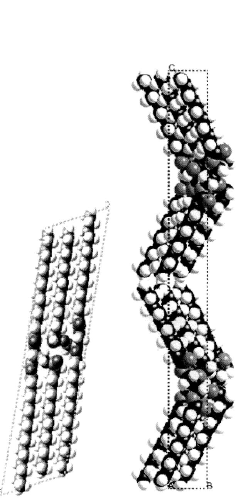

(a)
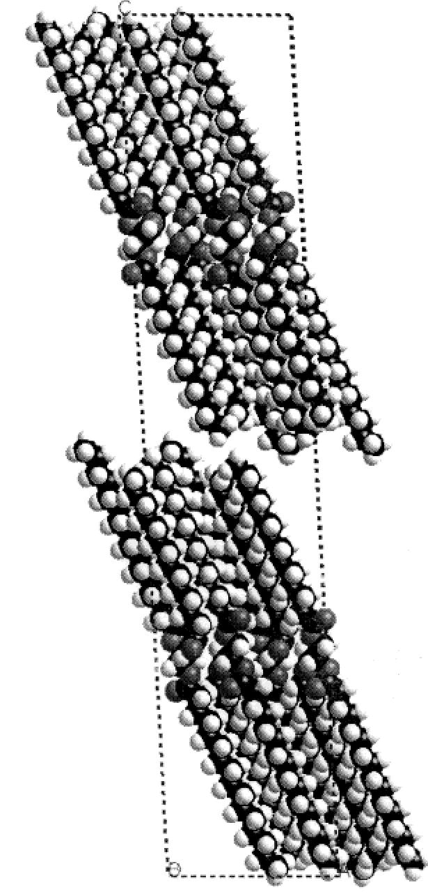

(c)
Figure 1. Unit cells of the \(\beta\)-16.16.16 (a), the \(\beta'\)-10.12.10 (b), and the \(\beta'\)-16.16.14 (c) TAGs showing the molecular configuration. For the \(\beta'\)-10.12.10, only four of the eight molecules are shown for clarity's sake. The four remaining molecules are obtained by applying the \(c\)-glide mirror perpendicular to the \(a\) axis.
section 3. The resulting morphologies will be compared with the experimental habits in section 4.
2. Crystal Structures
For the \(\beta\)-TAGs, we choose 16.16.16 as a representative. For this TAG, a crystallographic transformation has been applied similar to the one used by Hollander et al.\(^{1}\) This allows for an easy comparison of the various crystal structures and observed morphologies, both for the \(\beta'\)-TAGs and the \(\beta\)-TAGs. In Table 1, the crystallographic data of the TAGs are given together with
some morphological data. Figure 1 presents the conformation of the three TAGs in the unit cell. As can be judged from the table and the figure, the structures and morphologies of the three representative TAGs are rather different, both as the space group and number of molecules in the unit cell are concerned. The TAGs crystallize in different conformations. For the straight tuning fork conformation of the R1.R2.R3-TAG, the R1 and R3 chains are parallel to each other pointing in the opposite direction as compared to the R2 chain. For the straight chair conformation, R1 and R2 are parallel and both opposite to the R3 chain. The
<PAGE>
5682
J. Phys. Chem. B, Vol. 107, No. 24, 2003
Hollander et al.
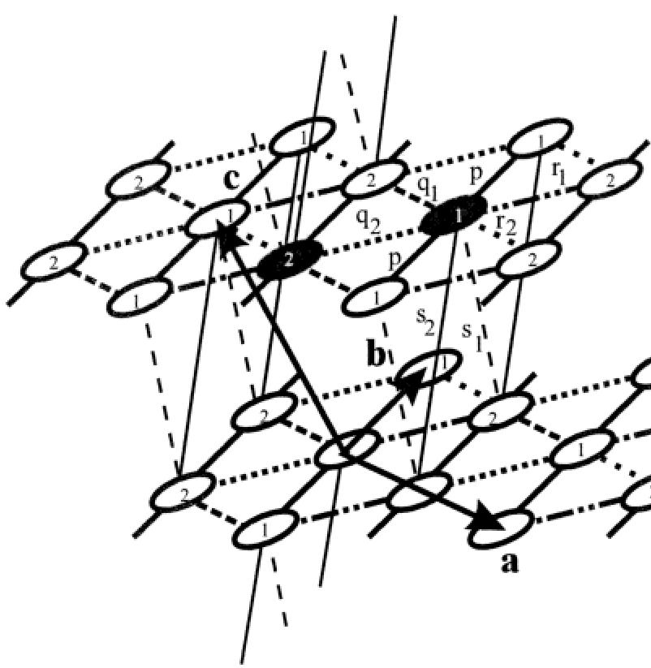

(a)
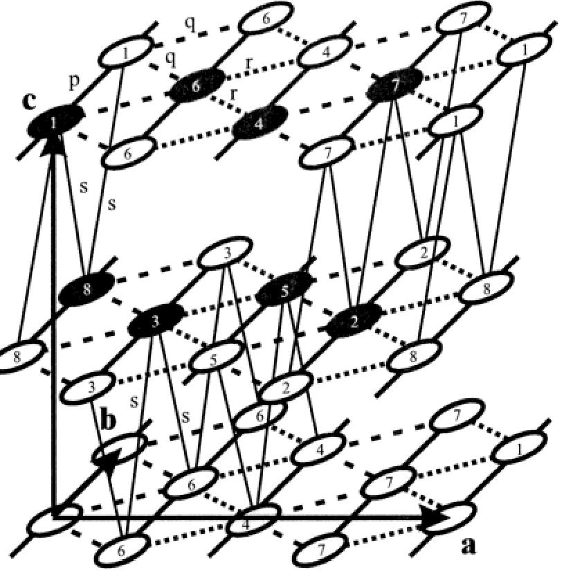

(b)
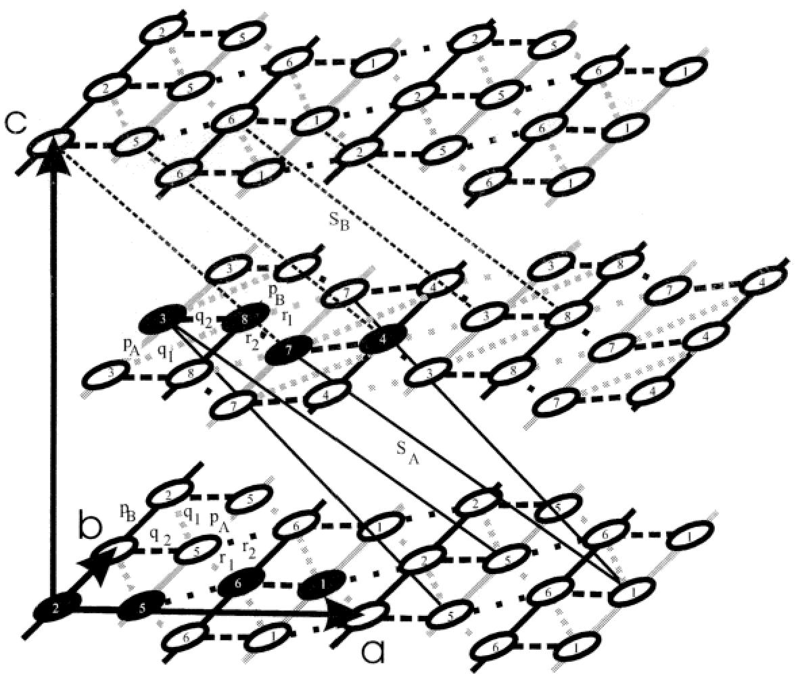

(c)
Figure 2. Crystal graphs of 16.16.16 (a), 10.12.10 (b), and 16.16.14 (c). The individual TAG molecules, i.e., the growth units, are represented by the circles. The growth units drawn in black are in the first unit cell. The R chains are approximately oriented along the c axes. The growth units M, are indicated by the subscript i. The bonds between the growth units are explained in the text (see also Table 2). For clarity's sake, in the case of 16.16.14, only the s bonds of one unit cell are drawn.
bent chair conformation shows a tilt between the parallel R1 and R2 chains as compared to the R3 chain. As the morphology is concerned, it has to be noted that the top faces found for the  \( \beta \) -n.n.n-TAGs depend on the chain length n. \( ^{1} \)
3. Connected Net Analysis
For the fundamentals of a connected net analysis, we refer to Grimbergen et al. \( ^{[11]} \)  To find all connected nets giving rise to the possible flat  \( (F-) \)  faces, the crystal graph representing all growth units (TAG molecules) and their mutual bonds is needed.
3.1. Crystal Graph. For a discussion on the relevant (nonbonded) intermolecular interactions—to which we refer as bonds—in the case of TAG crystals, we refer to the previous paper. \( ^{[1]} \)  In that paper, it was shown that in order to predict the correct morphology for the  \( \beta \) -TAGs merely a limited number
of bonds between the growth units has to be considered. In Figure 2, the crystal graphs of the three structures are given. Note that in the crystal graphs the molecules are represented by circles and that their positions are somewhat rearranged for clarity's sake without loss of the bonding topology and energetics. The molecules that make up the unit cell are drawn as full circles. In the figure, it can be seen that all three crystal graphs show a layered structure of TAG molecules in the \((a,b)\) plane. Within each layer, a TAG molecule is surrounded by six neighboring growth units in a distorted hexagonal pattern. The distortion depends on the actual TAG. For the \(\beta\)-TAGs, this results in five different bonds in the layer denoted as \(p,q_{1}, q_{2}, r_{1}\), and \(r_{2}\). These bonds are rather strong as they are a result of the interactions between the parallel \(R\) chains of neighboring growth units, which are roughly parallel to the \(c\)-axes. For the
<PAGE>
Morphology of  \( \beta \) -Monocaid TAG Crystals
J. Phys. Chem. B, Vol. 107, No. 24, 2003
5683
TABLE 2: Bond Energies for the Various Interactions in the Three Crystal Graphs of Figure 2 \( ^{a} \)
<table><tr><td rowspan="2">label</td><td colspan="3">\( \beta-16.16.16 \)</td><td colspan="3">\( \beta&#x27;-16.10.12.0 \)</td><td colspan="3">\( \beta&#x27;-16.16.14 \)</td></tr><tr><td>bond</td><td>energy</td><td>bond</td><td>energy</td><td>bond</td><td>energy</td><td>bond</td><td>energy</td><td>bond</td></tr><tr><td>\( p_{\text{A}} \)</td><td>1.1 [0·10]</td><td>-32.6</td><td>1.1 [0·10]</td><td>-26.5</td><td>3.3 [0·10]</td><td>-15.7</td><td>8.1 [0·10]</td><td>-17.0</td><td></td></tr><tr><td>\( p_{\text{B}} \)</td><td>-</td><td>-</td><td>-</td><td>-</td><td>8.8 [0·10]</td><td>-17.0</td><td>-</td><td>-</td><td>-</td></tr><tr><td>\( q_{1} \)</td><td>1.2 [0·00]</td><td>-24.0</td><td>1.6 [0·10]</td><td>-19.5</td><td>7.4 [0·10]</td><td>-22.8</td><td>-</td><td>-</td><td>-</td></tr><tr><td>\( q_{2} \)</td><td>1.2 [0·10]</td><td>-28·6</td><td>-</td><td>-</td><td>7.4 [0·00]</td><td>-40.8</td><td>-</td><td>-</td><td>-</td></tr><tr><td>\( r_{1} \)</td><td>1.2 [1·10]</td><td>-24·3</td><td>1.7 [1·10]</td><td>-16.1</td><td>8.7 [0·10]</td><td>-20.8</td><td>-</td><td>-</td><td>-</td></tr><tr><td>\( r_{2} \)</td><td>1.2 [100]</td><td>-29·1</td><td>-</td><td>-</td><td>8.7 [0·00]</td><td>-40.7</td><td>-</td><td>-</td><td>-</td></tr><tr><td>u</td><td></td><td></td><td></td><td></td><td>2.6 [100]</td><td>-8.84</td><td>-</td><td>-</td><td>-</td></tr><tr><td>x</td><td></td><td></td><td></td><td></td><td>1.5 [010]</td><td>-8.37</td><td>-</td><td>-</td><td>-</td></tr><tr><td>x</td><td></td><td></td><td></td><td></td><td>2.6 [110]</td><td>-2.70</td><td>-</td><td>-</td><td>-</td></tr><tr><td>y</td><td></td><td></td><td></td><td></td><td>1.5 [000]</td><td>-2.68</td><td>-</td><td>-</td><td>-</td></tr><tr><td>s1</td><td>1.2·[011]</td><td>-2.5</td><td>2.7 [000]</td><td>-1.4</td><td>-</td><td>-</td><td>-</td><td>-</td><td>-</td></tr><tr><td>s2</td><td>1.2·[001]</td><td>-2.8</td><td></td><td></td><td>1.7 [100]</td><td>-1.67</td><td>-</td><td>-</td><td>-</td></tr><tr><td>sA</td><td></td><td></td><td></td><td></td><td>1.8 [101]</td><td>-1.17</td><td>-</td><td>-</td><td>-</td></tr><tr><td>sB</td><td></td><td></td><td></td><td></td><td></td><td></td><td></td><td></td><td></td></tr></table>
* The bonds \( u, v, x \), and \( y \) have not been drawn in the figure. The bonds are denoted as \( M1.M2 \) [uvw] representing the interaction between growth unit \( M1 \) in the first unit cell [000] and growth unit \( M2 \) in the cell [uvw]. Note that the indices for the \( \beta \)-16.16.16-TAG differ from the ones in ref 1 because of a different choice for the unit cell. The energies are given in kcal/mol.
\(\beta^{\prime}\)-10.12.10-TAG, the space group symmetry reduces this set of bonds to only three denoted as \(p\), \(q\), and \(r\). For the \(\beta^{\prime}\)-16.16.14-TAG, the original set of five different bonds is enlarged to six as there are two \(p\) bonds present, denoted as \(p_{\mathrm{A}}\) and \(p_{\mathrm{B}}\). Furthermore, for this TAG, there are relatively strong next-nearest neighbor bonds in the layers. These bonds denoted as \(u\), \(v\), \(x\), and \(y\) are not drawn in the figure and will be treated in the next subsection. For the \(\beta\)-TAG, the unit cell contains one layer. The layers are mutually connected by relatively weak \(s_1\) and \(s_2\) bonds representing the head-tail interactions between the growth units. For the \(\beta'\)-10.12.10-TAG and the \(\beta'\)-16.16.14-TAG, there are two layers per unit cell. For 10.12.10, all interlayer bonds are equivalent and, therefore, denoted as \(s\) bonds. Note that the crystal symmetry lowers the number of \(s\) bonds between the layers. For 16.16.14, the \(s\) bonds are different for successive layers and, therefore, denoted as \(s_{\mathrm{A}}\) and \(s_{\mathrm{B}}\), respectively.
3.2. Calculated Bond Strengths. The method and force field applied to calculate the bond energies are similar to the ones used for the calculation of the bonds for the  \( \beta \) -n-n-n structures. \( ^{1} \)  The results are given in Table 2. The symmetry equivalent bonds can be found by applying the space group symmetry elements of the particular TAG.
3.3. Connected Nets. The next procedure in the morphology prediction is the determination of all connected nets which gives all possible flat  \( (F-) \)  faces on the morphology. On the basis of the crystal graphs of Figure 2, the connected nets were determined using the program FACELIFT. \( ^{12} \)  The selection rules according to the Bravais Friedel Donnay Harker (BFDH) rules were applied. \( ^{11} \)
For the  \( \beta^{\prime}-16.16.14 \) -TAG, this was done for the bond set including the u, v, x, and y bonds. The results can be found in Table 3. In this table, the forms are categorized as basal (B), side (S), and top (T) faces, based on the flat (needle) shape of the  \( \beta \) -n.n.n-TAGs and  \( \beta^{\prime} \) -n.n+2.n-TAGs. This classification is, however, less appropriate for the morphology of the  \( \beta^{\prime} \) -n.n.n-2-TAG. For this reason, we have adapted the classification per category presented in the previous paper. \( ^{1} \)  The present classification facilitates the comparison of the morphologies of the three different TAGs.
As an example of the application of the selection rules, we consider the absence of connected nets for the  \( \{010\} \)  faces for
TABLE 3: Forms  \( \{hkl\} \)  which Have at Least One Connected Net for the Three TAGs Studied \( ^{a} \)
<table><tr><td rowspan="2">face</td><td colspan="3">\( \beta-16.16.16 \)</td><td colspan="3">\( \beta&#x27;-10.12.10 \)</td><td colspan="3">\( \beta&#x27;-16.16.14 \)</td></tr><tr><td>\( \{hkl\} \)</td><td>\( E^{\text{int}} \)</td><td>#</td><td>\( \{hkl\} \)</td><td>\( E^{\text{int}} \)</td><td>#</td><td>\( \{hkl\} \)</td><td>\( E^{\text{snt}} \)</td><td>#</td></tr><tr><td>\( B_1 \)</td><td>\( \{001\} \)</td><td>-5.2</td><td>1</td><td>\( \{002\} \)</td><td>-5.44</td><td>1</td><td>\( \{001\} \)</td><td>-2.35</td><td>4</td></tr><tr><td>\( B_2 \)</td><td>\( \{101\} \)</td><td>-5.2</td><td>5</td><td>\( \{101\} \)</td><td>-3.84</td><td>8</td><td>\( \{202\} \)</td><td>-5.69</td><td>3</td></tr><tr><td>\( S_2 \)</td><td>\( \{100\} \)</td><td>-5.2</td><td>6</td><td>\( \{200\} \)</td><td>-64.33</td><td>1</td><td>\( \{203\} \)</td><td>-164.8</td><td>13</td></tr><tr><td>\( T_5 \)</td><td>\( \{010\} \)</td><td>-118.1</td><td>1</td><td></td><td></td><td></td><td></td><td></td><td></td></tr><tr><td>\( T_6 \)</td><td>\( \{011\} \)</td><td>-118.3</td><td>1</td><td></td><td></td><td></td><td></td><td></td><td></td></tr><tr><td>\( T_{1/4} \)</td><td>\( \{111\} \)</td><td>-113.5</td><td>1</td><td>\( \{112\} \)</td><td>-182.46</td><td>3</td><td>\( \{113\} \)</td><td>-196.17</td><td>4</td></tr><tr><td>\( T_{10} \)</td><td>\( \{110\} \)</td><td>-113.7</td><td>2</td><td></td><td></td><td></td><td>\( \{112\} \)</td><td>-254.75</td><td>8</td></tr><tr><td>\( T_{1C} \)</td><td>\( \{111\} \)</td><td>-122.3</td><td>1</td><td></td><td></td><td></td><td>\( \{111\} \)</td><td>-196.17</td><td>7</td></tr><tr><td>\( T_{1/D} \)</td><td></td><td></td><td></td><td></td><td></td><td></td><td></td><td></td><td></td></tr><tr><td>\( T_{2A} \)</td><td>\( \{211\} \)</td><td>-117.5</td><td>1</td><td>\( \{2\bar{1}1\} \)</td><td>-182.46</td><td>3</td><td></td><td></td><td></td></tr><tr><td>\( T_{2B} \)</td><td>\( \{210\} \)</td><td>-117.7</td><td>1</td><td></td><td></td><td></td><td></td><td></td><td></td></tr><tr><td>\( T_{3A} \)</td><td></td><td></td><td></td><td></td><td></td><td></td><td></td><td>\( \{316\} \)</td><td>-278.16</td></tr><tr><td>\( T_{3B} \)</td><td></td><td></td><td></td><td></td><td></td><td></td><td></td><td>\( \{314\} \)</td><td>-278.22</td></tr><tr><td>\( T_{3C} \)</td><td></td><td></td><td></td><td></td><td></td><td></td><td></td><td>\( \{314\} \)</td><td>-279.22</td></tr><tr><td>\( T_{3D} \)</td><td></td><td></td><td></td><td></td><td></td><td></td><td></td><td>\( \{313\} \)</td><td>-297.15</td></tr><tr><td>\( T_{3E} \)</td><td></td><td></td><td></td><td></td><td></td><td></td><td></td><td>\( \{317\} \)</td><td>-299.15</td></tr></table>
\( ^{a} \)  The faces are labeled as B (basal), S (side), and T (top) faces. The number of connected nets (#) for each form are given. In addition, the attachment energy of the strongest connected net for each form is entered in kcal/mol. For 16.16.16, the labeling has been adapted as compared to ref 1.
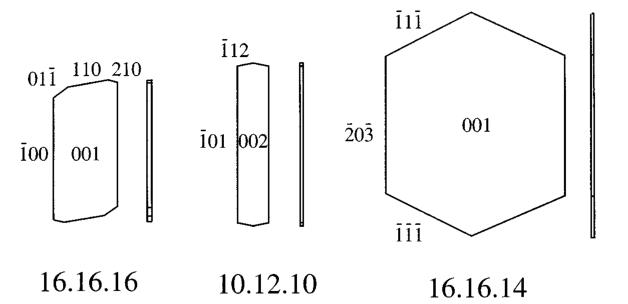

Figure 3. Morphology of the three TAGs based on the attachment energy prediction according to eq 1 and Table 3. For each TAG, two crystals are drawn, one viewed on top and one from the side. The b axis is chosen as the common vertical axis in all drawings.
the 10.12.10-TAG in Table 2. Figure 2b suggests that this face is connected due to the presence of bonds between all GUs in black in the conventional unit cell making up such a face. The space group, due to the centering translation \( I \), imposes as one of the selection rules the condition (0k0) with \( k \) even. This implies that the orientation (010) has as its proper layer thickness that of (020) growth slices. This is apparent from Figure 2b as the layer of GUs (in black) 1, 4, 3, and 2 is equivalent to the layer made up of the GUs 6, 7, 8, and 5, as a result of the centering translation \( I \). These two layers correspond to the (020) half layers in an (010) growth layer. The half layers are not connected as there is no bond between, e.g., GUs 1 and 4.
3.4. Morphology Based On the Attachment Energy. To predict the growth morphology, it is usually assumed that the growth rate  \( R_{hkl} \)  of a face (hkl) is linearly related to its (positive) attachment energy according to \( ^{34} \)
\[
R _ {h k l} = C E _ {h k l} ^ {\text {att}} \tag {1}
\]
Where \( C \) is a proportionality constant. If also the possible \( F \) faces are limited to those orientations that have at least one connected net (see section 3.3), one uses the attachment energy of the strongest connected net. The resulting morphology will be referred to as the attachment morphology in the following.
To be able to compare the experimental morphology and the morphology of a more elaborated prediction based on the edge energies of 2D nuclei with the attachment energy morphologies, the latter are presented in Figure 3. In this figure, the three morphologies have been drawn with the crystallographic b axis
<PAGE>
5684
J. Phys. Chem. B, Vol. 107, No. 24, 2003
Hollander et al.
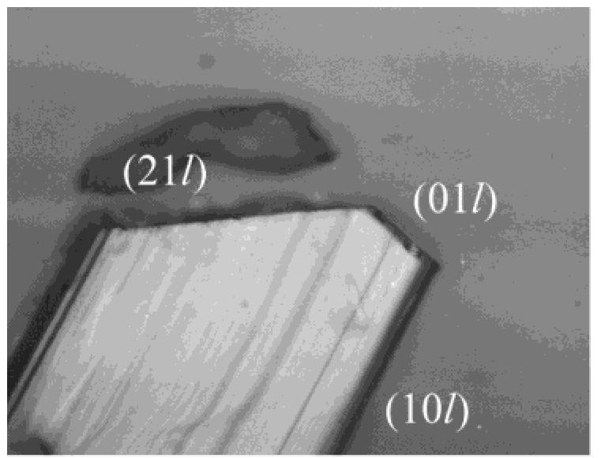

(a)
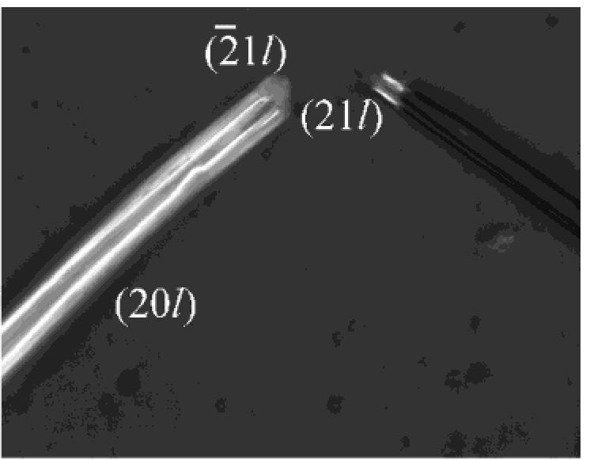

(b)
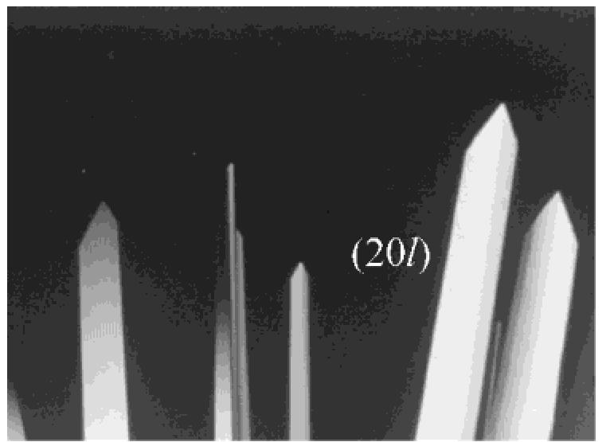

(c)
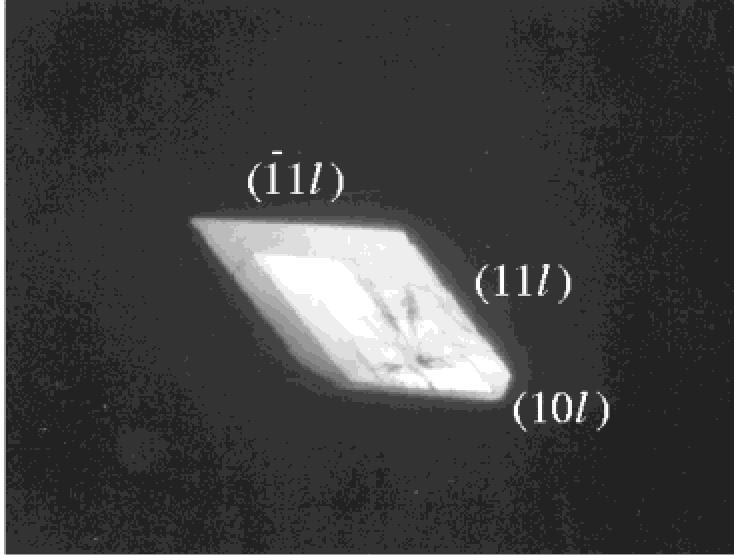

(d)
Figure 4. Photographic images of the growth morphology of the three TAGs. The faces are labeled according to their orientation and the BFDH-selection rules. The indices l are not specified as they are difficult to determine experimentally. All basal faces are  \( \{001\} \) . (a)  \( \beta \) -16.16.16 grown in dodecane. (b)  \( \beta' \) -10.12.10 grown from dodecane with  \( \{21l\} \)  faces. The occurrence of these faces is however not typical. In general these faces are rough. (c)  \( \beta' \) -10.12.10 grown from its melt. (d)  \( \beta' \) -16.16.14 grown in hexane. The seemingly top facet on the lower side of the crystal is due to accidental damage.
as the common axis. For the plank and flat needle morphology, this axis is along the long sides of the habit, whereas for the lozenge, it is along one of the bisecting axes of this habit.
4. Comparison With Experimental Morphology
In this section, the experimental morphologies of the three TAGs will be compared both with the attachment energy morphologies and the more elaborated prediction that is based on the determination of the edge energies of 2D nuclei formed on the F faces, that is, the faces that contain one or more connected nets. In Figure 4, some photographic images of the growth morphologies of the three TAGs are presented and indexed. The plank flat and needle shaped morphologies usually grow from spherulites showing only one of the two top sides. The index 1 is in all cases rather difficult to determine experimentally. \( ^{1} \)  This index is therefore not specified in Figure 4. The  \( \beta \) -16.16.16-TAG always shows faceted top faces for not too high supersaturations. The top faces of the  \( \beta' \) -10.12.10-TAG are invariably rather rough even at low supersaturations. Sometimes, at the lowest supersaturations, however, flat top faces are observed as can be seen in Figure 4b. Grown from the melt, this TAG seems to show faceted top faces which might be indexed as  \( \{6\}l1 \) . For higher supersaturations, however, the growth of these crystals is transport limited resulting in concave habits. \( ^{13} \)  The seamlessly faceted form with  \( \{6\}l1 \)  faces is an intermediate habit between the 2D-nucleation mechanism and transport limited growth. For the  \( \beta^{\prime}-16.16.14-TAG \) , the needle shape is drastically truncated resulting in lozenge shaped crystals.
Comparing Figures 3 and 4, the first striking difference is the by far more elongated experimental morphology of the plank
and flat needle shaped habits as compared to the attachment morphology. For the  \( \beta^{\prime}-16.16.14 \)  TAG, on the other hand, the experimental morphology is much less elongated along the b axis. As the top faces are concerned, the  \( \beta \) -TAG shows no  \( \{110\} \)  faces as were predicted, which was explained in ref 1. The top faces of the  \( \beta^{\prime}-10.12.10 \) -TAG are ill-predicted,  \( \{112\} \)  instead of  \( \{21\} \) . The top faces for  \( \beta^{\prime}-16.16.14 \)  are in correspondence with the prediction. In addition, the experimental morphology shows an  \( \{100\} \)  face which might be identified with the predicted  \( \{203\} \)  face. The seemingly appearing top facet on the lower side of the crystal is due to accidental damage. In the next section, we will explain the discrepancies between the experimental habits and the attachment morphologies on the basis of a more elaborate connected analysis.
4.1. Edge Energies of 2D Nuclei. As was discussed in the previous paper, \( ^{1} \) for the \( \beta \)-TAGs, the growth of the side and top faces of these TAGs is, because of the extremely thin nature of the crystals, mainly determined by a 2D nucleation mechanism. The same is expected to hold for the \( \beta^{\prime} \)-TAGs. Only for the top faces, spiral growth can play a role. Growth spirals were observed on the top faces of \( \beta \)-TAGs using atomic force microscopy. \( ^{14} \) Both for the 2D-nucleation mechanism and for the spiral growth mechanism, there are two main parameters that determine the growth rate of a crystal face. These are the driving force for crystal growth often expressed in terms of the supersaturation and the edge free energy of a 2D nucleus on the face. \( ^{15} \) A crystal face can grow via one of these two mechanisms as a flat face only when the corresponding orientation contains one or more connected nets of crystal bonds. \( ^{4} \) In that case, there exists a roughening transition temperature below which the flat orientation is maintained and
<PAGE>
Morphology of  \( \beta \) -Monocaid TAG Crystals
J. Phys. Chem. B, Vol. 107, No. 2, 2003
5685
above which the threshold for the formation of 2D-nuclei vanishes as the free energy of formation is zero. This phenomenon is called thermal roughening. The roughening transition temperature of a face \((hkl)\) is determined by the edge free energy of nuclei on that face. If in any direction along the face the edge free energy of a 2D nucleus becomes, zero the face will be rough.\(^{11,16}\) Above its roughening temperature, a face will start to grow relatively fast either disappearing from the morphology leaving behind other faces or appear as a rounded off orientation. Below its roughening temperature, a face can still lose its flat appearance beyond a certain threshold driving force. This is called kinetical roughening.\(^{11,17}\) Therefore, faces with relatively small edge free energies for 2D nucleation are expected to kinetically roughen already at relatively small driving forces. Thus, besides the driving force, the main parameter for determining the growth rate of a crystal face is its edge (free) energy for the formation of a 2D nucleus. Especially for anisotropic crystal structures such as for the present TAGs, one finds large differences in the 2D-nucleation edge free energy in different directions along the various faces.\(^{1}\) In the following subsections, we will study the three different TAGs in detail to find the edge (free) energies for 2D nuclei. We will only focus on the edge energies of 2D-nuclei, neglecting entropic contributions.
4.2. \(\beta\)-16.16.16. The elongated morphology of the \(\beta\)-TAGs as compared to the attachment morphology was already explained in the previous paper on the basis of a determination of the edge energies of 2D nuclei formed on the top faces of these crystals.\(^{1}\) From the edge energies, the roughening temperatures were estimated. The edge energies were much smaller than expected from the attachment energy calculations, and moreover, it was shown that depending on the chain lengths of the flat facets the morphological importance of the various top faces differed considerably. For 16.16.16, in particular, this resulted in the presence of only \(\{212\}\) and \(\{011\}\) faces, the \(\{111\}\) faces having a far too small 2D edge energy to be present. For the basal and side faces, the effect of small edge energies for 2D nucleation was absent and very small, respectively.\(^{1,2}\) The results turned out to be in perfect accordance with the experimental observations. We will use the same approach to explain the morphology of the two \(\beta^{\prime}\)-TAGs.
4.3. \(\beta^{\prime}\)-10.12.10. For the \(\beta^{\prime}\)-10.12.10-TAG, the far more elongated morphology as compared to the \(\beta\)-TAGs can partly be explained by the smaller enhancement energies of the \(\{101\}\) side faces as compared to the \(\beta\)-TAG. Therefore, the needle shape must also be caused by even smaller edge energies for the top faces. Moreover, the fact that these top faces almost invariably grow as rounded-off faces shows that the threshold for kinetic roughening is by far lower for this TAG. We will study the stability of both top forms \(\{11\bar{2}\}\) and \(\{2\bar{1}1\}\) in more detail in the next sections. Although the bond topologies of the most stable connected nets of these two faces are exactly identical—resulting in equal attachment energies (see Table 3)—their growth behaviors are significantly different, which can only be explained by the subtle differences in edge energies.
4.3.1. The  \( \{\overline{1}\overline{1}2\} \)  Top Faces. In Figure 5, a perspective view of the crystal graph of the  \( \beta^{\prime}-10.12.10-TAG \)  is drawn (compare Figure 2). Note, that the graph is somewhat deformed as compared to Figure 2b, to make the details in the various layers more clear. Of the three connected nets for the  \( \{\overline{1}\overline{1}2\} \)  faces, the one with the smallest attachment energy is drawn in heavy gray lines. In each layer, the profile of the surface of this connected net is drawn by the heavy black lines along the overall direction [110]. In addition, along the same direction, the profile
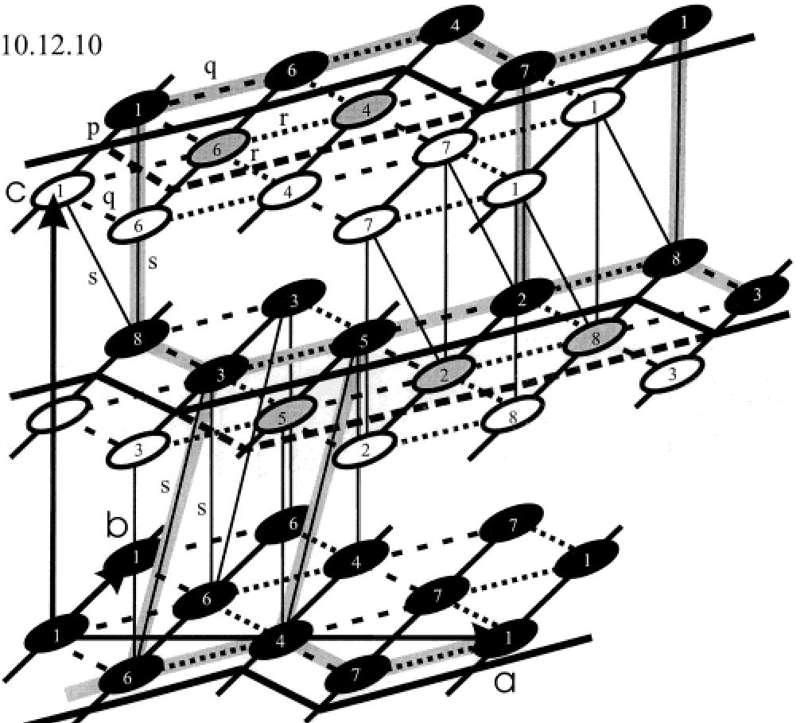

Figure 5. Perspective view of a  \( \{1\bar{1}2\} \)  connected net drawn in heavy gray lines in the crystal graph of 10.12.10. The graph is somewhat deformed as compared to Figure 2, to make the details more clear. The surface profile of the corresponding  \( \{11\bar{2}\} \)  face is drawn as heavy black lines. All GUs in the crystal are drawn in black. A 2D nucleus is drawn on top of the profile in heavy black dashed lines. The gray GUs are part of a 2D nucleus and the white ones are not part of the crystal. The edge energy of this nucleus along the  \( \{110\} \)  direction is very small as explained in the text.
of a 2D nucleus is drawn, in heavy black dashed lines. For the middle layer of GUs, this nucleus involves the addition of three consecutive growth units 8, 2, and 5 (indicated as gray spheres) which proves to be the most favorable nucleation mechanism on this crystal face. The nucleation mechanism can be described quantitatively by means of the edge energy of the resulting profile along the \(\{110\}\) direction. The edge energy is obtained by subtracting the values of the broken bond energies of the profile without the 2D nucleus from the values of the broken bonds corresponding to the profile defined by the 2D nucleus. The resulting edge energy of this 2D nucleation mechanism is determined by the weak \(s\) bonds because the strong \(p, q,\) and \(r\) bonds cancel as a result of the plane symmetry in the (001) layers of GUS (compare Figure 2). Adding GU 8 to the flat \(\{112\}\) face introduces an edge energy of \(2s\). Adding the neighboring GU 2 increases the total edge energy by \(4s\). Once this small nucleus is present, the third GU 5 can be added freely, leaving the edge energy at \(4s\). Enlarging the nucleus by adding the GU 3 would cause an increase of the edge energy of \(2q\), which would be a rate limiting step in this nucleation mechanism. However, this can be circumvented by first adding another GU 8 (the leftmost GU in this layer in Figure 5). This only requires an additional \(2s\) in edge energy. After the neighboring 2D nucleus is established, the GU 5 can be added without any increase of the edge energy. Because of the translational symmetry (body centered, \(l\) cell), the GLs 4, 6, 1, and 7 can play the respective roles of 8, 2, 5, and 3 with identical edge energies in the other layer of GUs. If, however, the GUs 1 and 7 in the top layer had been added first, GLs 2 and 8 could have been added without any additional broken bonds. Such detailed inspection leads to the conclusion that the effective edge energy needed for this 2D nucleation mechanism amounts to no more than an average of one \(s\) bond per GU in the nucleus. In a recent publication, we erroneously overlooked this small edge energy, stating that this energy was always zero by a clever choice of
<PAGE>
5686
J. Phys. Chem. B, Vol. 107, No. 24, 2003
Hollander et al.
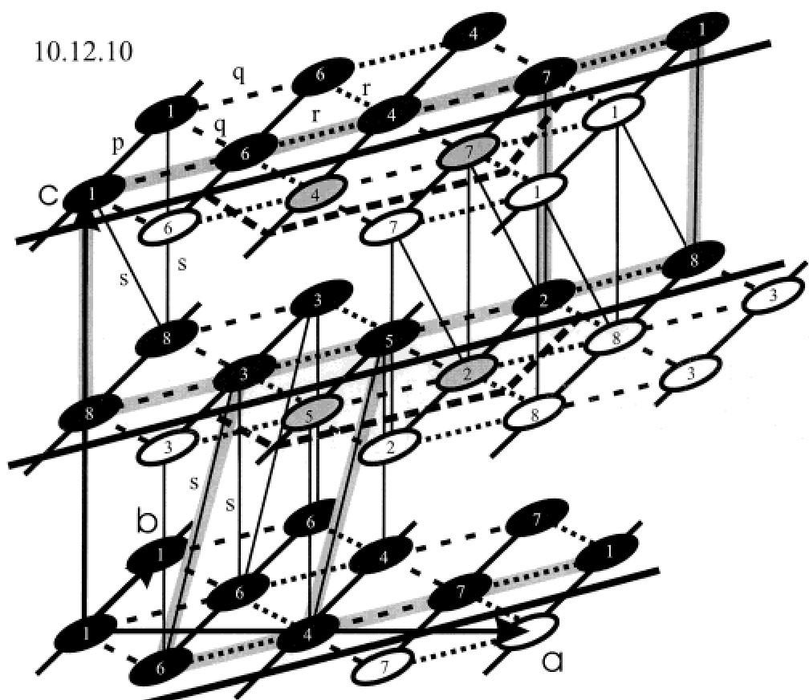

Figure 6. Perspective view of a  \( \{2\bar{1}1\} \)  connected net of 10.12.10 drawn in heavy gray lines. The graph is somewhat deformed as compared to Figure 2, to make the details more clear. All GUs in the crystal are drawn in black. The gray GUs are part of a 2D nucleus and the white ones are not part of the crystal. In this case, no 2D nucleus can be found which cuts only s bonds. Two 2D nuclei with small edge energies are indicated by the heavy black dashed lines.
the 2D nucleus. \( ^{10} \)  Monte Carlo simulations presented in that paper, performed at room temperature, showed a roughened face already at zero driving force.
The present result showing a finite though very small edge energy led us to review the simulation results. This brings us to the conclusion that those simulation results must be interpreted as an example of a special kind of—nearly unhindered—2D nucleation caused by a specific order of addition of growth units keeping a minimal total edge energy. We will elucidate those results in detail in a forthcoming publication. \( ^{18,19} \)  Because of this particular type of roughening effect, the  \( \{1\bar{1}2\} \)  faces grow relatively fast and are unlikely to appear on the crystal morphology of the 10.12.10-TAG.
4.3.2. The \(\{2\bar{1}1\}\) Top Faces. The other top face of the 10.12.10-TAG according to Table 3 is the \(\{2\bar{1}1\}\) orientation. In Figure 6, a drawing of the corresponding face is given in a way similar to that of the \(\{1\bar{1}2\}\) face. For this face, it is no longer possible for GU 8 to adhere with an edge energy only determined by \(s\) bonds. In fact, the most favorable growth units are now GU 3 and 7, which upon addition, each result in an edge energy of \(2\sigma\), which is more than an order of magnitude larger than the \(2s\) bonds of the comparable nucleus for the \(\{1\bar{1}2\}\) face. The addition of GU 7 can be followed most favorably by GU 4 which increases the total edge energy to \(2r + 2s\). This nucleus is depicted in Figure 6 by the gray GUs in the upper layer. Next GUs 6 and 1 can be added, etc. In terms of pairs of GUs, the nucleus can be elongated in the \(\{1\bar{2}0\}\) direction resulting in a total edge energy of \(2r + 2Ns\) for \(N\) pairs in the nucleus. Obviously, the same holds for the GUs in the other layer. Similar to the other top face, again some of the \(s\) bonds are cancelled if such nuclei are formed in adjacent layers. The total edge energy, then, will amount to \(2Mr + Ns\), for nuclei consisting of \(M\) layers, each having \(N\) GUs.
This implies that, once a nucleus of 2 GUs is formed, further growth in the [120] direction can take place at the same rate as that of the {112} faces. For each new layer, however, a relatively high energy barrier of \(2r\) has to be overcome, resulting in a higher supersaturation threshold for appreciable growth. Al
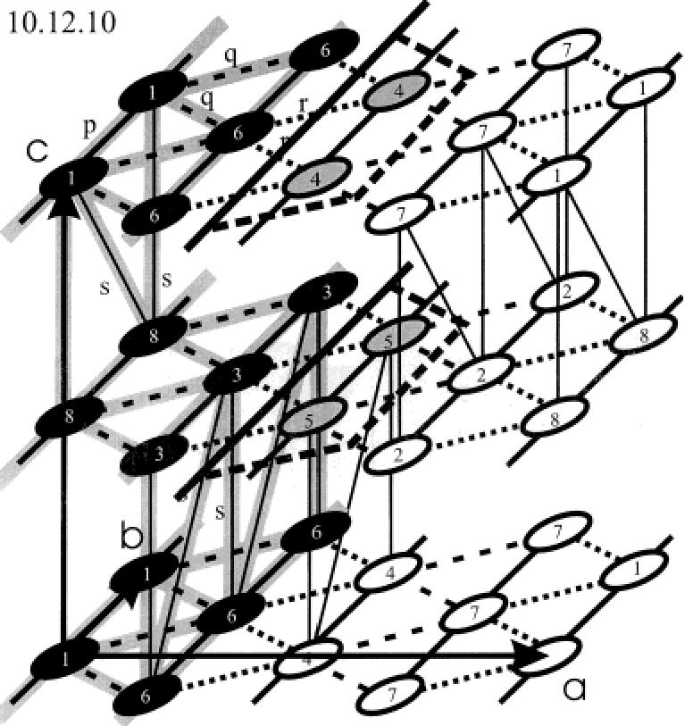

Figure 7. Perspective view of a (200) connected net of 10.12.10 drawn in heavy gray lines. The graph is somewhat deformed as compared to Figure 2, to make the details more clear.All GUs in the crystal are drawn in black. The surface profile of the connected net is drawn as an emphasized solid black line only for the upper two layers. The 2D nucleus with the smallest edge energy is indicated by the heavy black dashed lines. The gray GUs are part of the 2D nucleus and the white ones are not part of the crystal.
though the connected nets (and their attachment energies) of the  \( \{2\bar{1}1\} \)  and  \( \{11\bar{2}\} \)  faces are identical, it is demonstrated that the  \( \{11\bar{2}\} \)  faces maintain a much lower edge energy throughout its growth mechanism. Therefore, the  \( \beta^{\prime}-10,12,10 \) -TAG crystals are expected to grow only with faceted  \( \{2\bar{1}1\} \)  faces for not too high supersaturations. The kinetical roughening threshold for these faces is determined by the combination of  \( 2r \)  bonds and a number of low energy s bonds depending on the size of the nucleus. This threshold is still fairly low as a result of the effective cancellation of the much stronger p bonds. In other words, the  \( \beta^{\prime}-10,12,10 \) -TAG crystals are expected to grow as very elongated needles with top faces that roughen kinetically at very low supersaturations. This leaves the question why the side faces grow relatively slowly as compared to these top faces.
4.3.3. The  \( \{200\} \)  Side Faces. For the n.n.n-TAGs, it was already shown that the side faces have a relatively small growth rate as compared to the top faces by estimating the roughening temperatures which turned out to be much higher for the side faces. \( ^{1,2} \)  We will explain this difference for the 10.12.10-TAG by studying the 2D nucleation on one of its two possible side faces. Although Table 3 suggests that the  \( \{101\} \)  face is the appropriate candidate because of its smaller attachment energy, detailed inspection shows that the  \( \{200\} \)  face is equally stable. Because of the less complex representation of the latter in the crystal graph, we will study the  \( \{200\} \)  face in more detail. Figure 7 shows the only connected net present for this orientation in heavy gray lines. From the figure, it can be easily seen that any 2D nucleus, including both layers, on this face has an edge energy determined by 2p bonds per layer of GLi, independent of the length of the nucleus along the [010] direction and on the average  \( (2(q - r) + 4s) \)  bonds per growth unit in the nucleus. When we compare this result with that for the  \( \{211\} \)  form, we, first of all, note the much higher edge energy for 2D nucleus profiles along the high energy direction ([010] for the  \( \{200\} \)  face) that, moreover, depends on the number of growth units in the nucleus. This is because now the q and r bonds do not cancel completely as they do in the case of the top faces. Second, in the low edge energy direction (for profiles along [001] in
<PAGE>
Morphology of  \( \beta \) -Monocaid TAG Crystals
J. Phys. Chem. B, Vol. 107, No, 24, 2003
5687
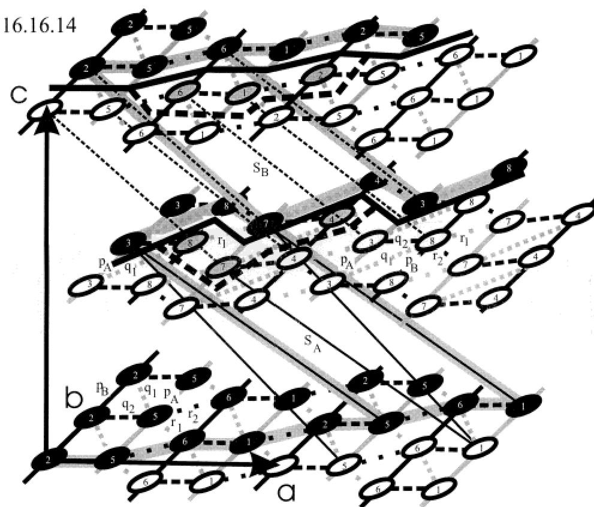

Figure 8. Perspective view of a  \( \{1\bar{1}1\} \)  connected net of 16.16.14 drawn in heavy gray lines. All GUs in the crystal are drawn in black. The surface profile of the connected net is drawn as an emphasized solid black line only for the upper two layers. The  \( 2D \)  nucleus with the smallest edge energy is indicated by the heavy black dashed lines. The gray GUs are part of the 2D nucleus and the white ones are not part for the crystal. For clarity's sake, not all of the s bonds are drawn.
Figure 7), the edge energy amounts to 4s bonds per growth unit which in itself is already 4 times larger than the value found for the  \( \{2\bar{1}1\} \)  form.
In summary, an  \( M \times N \)  nucleus would amount up to  \( M(2(q - r) + 4s) + N2p \)  bonds. This is in all cases much higher than that of the top faces, which perfectly explains the elongated needle shape of the crystals. A similar edge size-energy relation could be derived for the  \( \{10\bar{1}\} \)  faces, but it is still not clear whether the side faces of the 10.12.10 needles are made up of  \( \{10\bar{1}\} \)  or  \( \{200\} \)  faces (or both).
Comparing the  \( \beta^{\prime}-10.12.10-TAG \)  and the  \( \beta-16.16.16-TAG \)  crystals, given the comparable topology of the top faces, the former are expected to show even more more elongated needles as the s bonds of the former are weaker by a factor of almost 2.
4.4. \(\beta^{\prime} - 16.16.14\). The \(\beta^{\prime} - 16.16.14\)-TAG has a morphology that is very different as compared to the ones discussed up to now. The top faces are heavily retarded in growth rate, whereas the side faces grow relatively fast. The small edge energies found for one of the top faces of the \(\beta^{\prime} - 10.12.10\)-TAG are not expected as the symmetry of the \(16.16.14\)-TAG is much lower resulting in six different bonds in the \((a,b)\) layers.
The top faces that have connected nets can be divided in two groups according to Table 3, namely, the  \( \{31l\} \)  forms with l = 3, -, 7 and the  \( \{11l\} \)  forms for which l = 0, -, 3. For the side faces, only the  \( \{20l\} \)  (l = 3, 4) forms have connected nets. The experimental morphology in Figure 4d suggests that in contrast to the attachment energy prediction in Figure 3 the side faces grow relatively fast as compared to the top faces. To explain this discrepancy, we will study the side and top faces of Figure 3 in terms of the edge energies for 2D nucleation. We will limit ourselves to the most stable forms, in terms of the attachment energy, according to Table 3, that is, the  \( \{111\} \)  top and  \( \{203\} \)  side faces.
4.4.1. The  \( \{111\} \)  Top Faces. Figure 8 shows a perspective drawing of the  \( \{1\bar{1}1\} \)  connected net as a representative of the  \( \{111\} \)  form of 16.16.14. As in the previous figures, the heavy gray lines represent the connected net, and the emphasized black lines represent the corresponding surface profile. To find the
2D nucleus, on top of this connected net, that has the smallest edge energy in this rather complicated crystal graph, we first look at Table 2. This table shows that the strongest bonds are \( q_{2} \) and \( r_{2} \), which have about the same energy of 41 kcal/mol. These bonds are the black dashed bonds in Figure 8. The next strongest bonds are \( q_{1} \) (23 kcal/mol) and \( r_{1} \) (21 kcal/mol), almost equal in strength, indicated by the gray dashed bonds in the figure. The \( p_{\mathrm{A}} \) and \( p_{\mathrm{B}} \) bonds (16 and 17 kcal/mol, respectively) enter the figure as the gray and black solid bonds. We neglect the other more weak in-layer bonds \( u, v, x \), and \( y \). The interlayer \( s_{\mathrm{A}} \) and \( s_{\mathrm{B}} \) bonds are, again, relatively weak: 2 and 1 kcal/mol, respectively. To keep the analysis simple we will treat the \( q_{2} \) and \( r_{2} \) bonds as equal; the same will be done for the \( (q_{1}, r_{1}) \) and the \( p_{1}, p_{0} \) couples. Note that the difference in bond strengths for these couples, which amounts 1-2 kcal/mol, is comparable to the strengths of the \( s \) bonds.
Detailed inspection of Figure 8 shows that a 2D nucleus of any length in the upper layer cuts besides some weak s bonds always two bonds of type  \( q_{2} \)  or  \( r_{2} \)  more than the profile without a 2D nucleus.
In the lower—that is middle—layer a very interesting situation occurs. The dashed profile of the 2D nucleus drawn for this layer contains three growth units. The addition of only the left growth unit labeled  \( \S \)  results in an almost zero edge energy assuming the equality of the bonds coming in couples and neglecting the s bonds. The same holds for the complete 2D nucleus—and any extension of it with two growth units—indicated for this lower layer.
This shows that the edge energy of a complete 2D nucleus including both layers along the [110] direction along the (111) face is mainly determined by the edge energy of the upper layer and amounts roughly to two \( q_{2} \) or \( r_{2} \) bonds. Comparing this 2D edge energy of the (111) top face with that of the 10.12.10 {211} top faces, we find values of some 82 and 32 kcal/mol, respectively. Along the direction of the \( \hat{s} \) bonds, the 2D edge energy is determined by the strongest \( x_{\Delta} \) bonds and amounts to \( (1x_{\Delta} + 3/2x_{\mathrm{B}}) \) per growth unit. The latter edge energy depends somewhat on the shape of the total nucleus. Therefore, the edge energy of the total nucleus is independent of the size of the nucleus in the high energy direction along [110] but depends on the number of growth units in the nucleus in the low energy direction along the s bonds.
When we compare this result with that of the  \( [\tilde{2}11] \)  top faces of 10.12.10, taking into account the energy of the s bonds (cf. Table 2), we find a  \( 2 \times 4 \)  times as high edge energy in the s bond direction for the 16.16.14-TAG. This explains, together with the 2.6 times as high edge energy along the  \( [110] \)  direction, the retarded growth of the top faces for this TAG.
4.4.2. The  \( [203] \)  Side Faces. Figure 9 shows the strongest connected net, in terms of attachment energy, of the  \( [203] \)  side face in heavy gray lines. Inspection of the figure shows that the 2D nucleation edge energy along the [010] direction in each layer is determined by two  \( p_{\Delta} \)  or  \( p_{B} \)  bonds, independent of the size of the nucleus, assuming the same equality of bonds coming in couples as in the preceding section. Comparing this result for the present side face with that of the  \( \{111\} \)  top faces, we find some 33 and 82 kcal/mol, respectively. Along the [302] direction the 2D edge energy is, again, determined by only s bonds. The 2D nucleus drawn in the upper middle layer has an edge energy of  \( 1s_{B} \)  bond, or 1.2 kcal/mol per growth unit. Adding the nucleus of the lower middle layer, effectively costs another  \( 2s_{A} - s_{B} \)  bonds, or 2.1 kcal/mol per growth unit extra. In the other two layers, a comparable but independent 2D nucleus can be constructed. In conclusion, the average edge
<PAGE>
5688
J. Phys. Chem. B, Vol. 107, No. 24, 2003
Hollander et al.
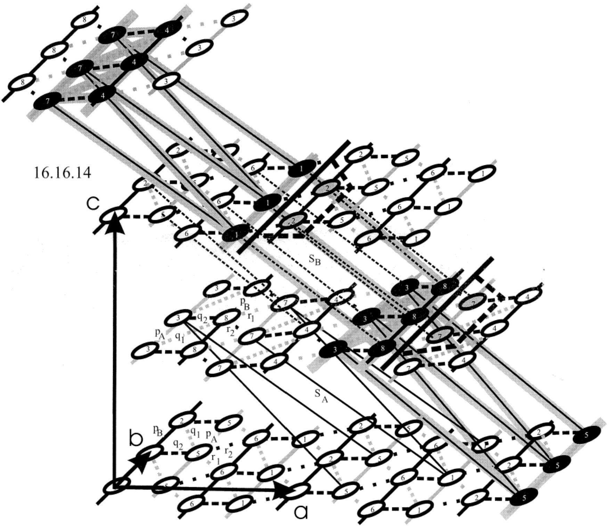

Figure 9. Perspective view of a  \( \{203\} \)  connected net of 16.16.14 drawn in heavy gray lines. For clarity's sake, a 2D nucleus is drawn only in the two middle layers together with emphasized solid black lines representing the surface profile of the connected net. For the same reason, only the growth units in the outer layer of the surface are drawn in black; the gray ones are part of the 2D nucleus.
energy of a complete 2D nucleus is determined by that of 2D nuclei of the type drawn in Figure 9 and the edge energy is in both the high and low energy directions 2–3 times as small as for the  \( \{111\} \)  top faces.
Therefore, the  \( \{111\} \)  top faces of 16,16,14 are expected to grow more slowly as compared to the  \( \{203\} \)  side faces, resulting in pseudohexagonal or even lozenge shaped morphologies as in Figure 4d.
5. Conclusion
It is shown that the crystal morphology of three different monoclad triacylglycerols (TAGs), i.e.,  \( \beta \) -16,16,16,  \( \beta' \) -10-12,10, and  \( \beta' \) -16,16,14 fat crystals, can be understood on the basis of a connected net analysis taking into account the edge energies relevant for a 2D nucleation growth mechanism. Moreover, it is shown that the conventional prediction of the morphology on the basis of attachment energies is not capable of explaining the very different morphologies of these fat crystals. First of all, the aspect ratio is badly predicted for all three TAGs. Second, the top faces that determine whether a TAG grows as needles is ill-predicted by the attachment energy method.
For the  \( \beta \) -16.16.16-TAG, the top faces all have an edge (free) energy for 2D nucleation that is much smaller than expected on the basis of the attachment energy method. This is because of the bonding topology of the connected nets of these faces, of which the edge energy is determined both by slice and attachment energy bonds. As a result, the edge energy is
determined by differences between bonds of the crystal which can be very small if these bonds are comparable in strength. This results in relatively low roughening temperatures and, therefore, fast growth rates as was explained in a previous paper. \( ^{1} \)  The morphology of these TAGs is, therefore, elongated plank shaped.
For the  \( \beta^{\prime} \) -10.12.10-TAG, the space group symmetry is so high that there are only two top faces that contain connected nets and, therefore, could theoretically appear as flat faces. Moreover, the edge energy for one of these two top faces,  \( \{1\bar{1}2\} \) , is so small that they can grow practically unhindered already at a very small supersaturation. These faces are, therefore, expected not to appear on the growth morphology. The other top face has a larger but, compared to the  \( \beta \) -16.16.16-TAG, still small edge energy. For the  \( \beta^{\prime} \) -10.12.10-TAG, we have explained the origin of the needle shape also in terms of the 2D nucleation edge energies relevant for the top faces and side faces. In contrast to the situation for the side faces, for the top faces, the edge energy is only dependent on the number of growth units in the 2D nucleus in terms of the weak s bonds. This, together with the small edge energy, lowers the threshold for the formation of a 2D nucleus of critical size considerably, resulting in relatively high growth rates.
The  \( \beta^{\prime}-16.16-14-TAG \)  has a completely different, lozenge shaped morphology. For this TAG, the order in terms of strength of the bonds in the layers of the structure is different from the other two TAGs; the p bonds in Figure 2 (cf. Table 2) are the
<PAGE>
Morphology of  \( \beta \) -Monocaid TAG Crystals
J. Phys. Chem. B, Vol. 107, No. 24, 2003
5689
strongest bonds for the first two TAGs, whereas for the  \( \beta^{\prime}-16,16,14-TAG \) , the  \( q_{2} \)  and  \( r_{2} \)  bonds are the strongest. As a result, the side faces grow faster as compared to the two other TAGs due to less strong bonds relevant for the edge energy and the top faces have relatively low growth rates.
The present paper shows that it is important for crystal morphology prediction to take the actual growth mechanism seriously into account. A connected net analysis together with the determination of edge (free) energies of 2D nuclei on top of these nets can explain morphologies that are not predicted by conventional methods. Although the present analysis is limited to a 2D nucleation growth mechanism, it has to be noted that the edge free energy is, besides the driving force for crystallization, also a parameter that enters the growth rate equations for spiral growth. Moreover, roughening temperatures and parameters for lenticular groheing heavily depend on the edge free energy. \( ^{15} \)  Roughening effects are rarely taken into account in conventional morphology prediction methods. This paper, also, shows the relevance of such effects on crystal morphology, especially for the 10,12,10-TAG.
In a forthcoming paper, we will confront the present analysis for all three TAGs with results from Monte Carlo simulations of crystal growth rates using a program called MONTY that is capable of performing simulations based on the crystal graph, taking into account the actual bond structure and strengths. \( ^{18,19} \)  In addition, we are working on crystal growth models based on a statistical mechanical approach to understand the growth mechanism of crystals with complicated crystal graphs such as the ones in the present paper.
Acknowledgment. This project was partly supported by The Netherlands Foundation for Chemical Research (CW) with financial aid from Organon and The Netherlands Organization for Scientific Research (NWO), in the framework of the PPM/ CMS crystallization project. We would like to acknowledge the referee for pointing us to the small non-zero edge energy in section 4.3.1.
References and Notes
(1) Hollander, F. F. A.; Boerrigter, S. X. M.; van de Streek, C. J.; Grimbergen, R. F. P.; Meekes, H.; Bennema, P. J. Phys. Chem. B 1999, 103, 8301.

(2) Bennema, P.; Hollander, F. F. A.; Boerrigter, S. X. M.; Grimbergen, R. F. P.; van de Streek, J.; Meekes, H. In Crystallization processes in fats and lipid systems; Garti, N., Sato, K., Eds.; Marcel Dekker Inc.: New York, 2001; pp 99–150.
(3) Hartman, P.; Bennema, P. J. Crystal Growth 1980, 49, 145.
(4) Bennema, P.; van der Eerden, J. P. Morphology of crystals; Terra Scientific Publishing Company (TERRAPUB): Tokyo, Japan, 1987; pp 1–75.
(5) van Langevelde, A.; van Malssen, K.; Hollander, F. F. A.; Peschar, R.; Schenk, H. Acta Crystallogr. B 1999, 55, 114.
(6) Hagemann, J. W. In Crystallization and polymorphism of fats and fatty acids; Garti, N., Sato, K., Eds.; Marcel Dekker Inc.: New York, 1989; pp 9–95.
(7) Birker, P. J. M. W. L.; Jong, S. D.; Roijers, E. C.; Soest, T. C. V. J. Am. Oil Chem. Soc. 1991, 68, 895.
(8) Langevelde, A. van; van Malssen, K.; Driessen, R.; Goubitz, K.; Hollander, F. F. A.; Peschar, R.; Zwart, P.; Schenk, H. Acta Crystallogr. B 2000, 56, 1103.
(9) Sato, K.; Goto, M.; Yano, J.; Honda, K.; Kodali, D. R.; Small, D. M. J. Lipid. Res. 2001, 42, 338.
(10) Boerrigter, S. X. M.; Hollander, F. F. A.; van de Streek, J.; Bennema, P.; Meekes, H. Cryst. Growth Design 2002, 2, 51.
(11) Grimbergen, R. F. P.; Meekes, H.; Bennema, P.; Strom, C. S.; Vogels, L. J. P. Acta Crystallogr. A 1998, 54, 491.
(12) Boerrigter, S. X. M.; Grinbergen, R. F. P.; Meekes, H. FACELIFT-2.50, a program conceived net analysis; Department of Solid State Chemistry, University of Nijmegen: Nijmegen, The Netherlands, 2001; E-mail: hugom@scik.uni.nl.
(13) Hollander, F. F. A.; Kaminski, D.; Duret, D.; van Eeckhout, W. J. P.; Meekes, H.; Benemma, P. Food Res. Int. 2002, 35, 909.
(14) Hollander, F. F. A.; Peppert, M.; van de Streek, J.; van Euckevort, W. J. P. Surf. Sci. 2001, 471, 101.
(15) van der Eerden, J. P. Handbook of Crystal Growth; Elsevier: Amsterdam, 1993; Vol. 1, pp 307–475.
(16) van Beijeren, H.; Nolden, I. M. Topics in current physics, structure and Dynamics of Surfaces II; Springer-Verlag: New York, 1986; Vol. 43, pp 259–300.
(17) Jetten, L. A. M. J.; Human, H. J.; Bennema, P.; van der Eerden, J. P. J. Cryst. Growth 1984, 68, 503.
(18) Boerrigter, S. X. M.; Josten, G. P. H.; Meekes, H. MONTY, a program for Monte Carlo on any crystal surface; Department of Solid State Chemistry, University of Nijmegen: Nijmegen, The Netherlands, 2001; E-mail: hugom@ski.kun.nl.
(19) Boerrigter, S. X. M.; Josten, G. P. H.; van de Streek, J.; Hollander, F. F. A.; Los, J.; Benemma, P.; Meekes, H. To be published.