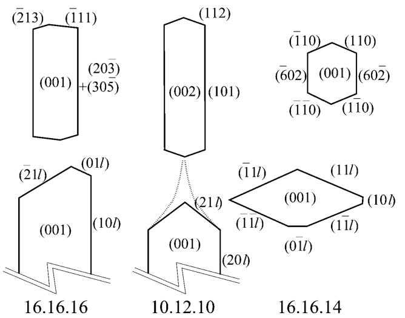
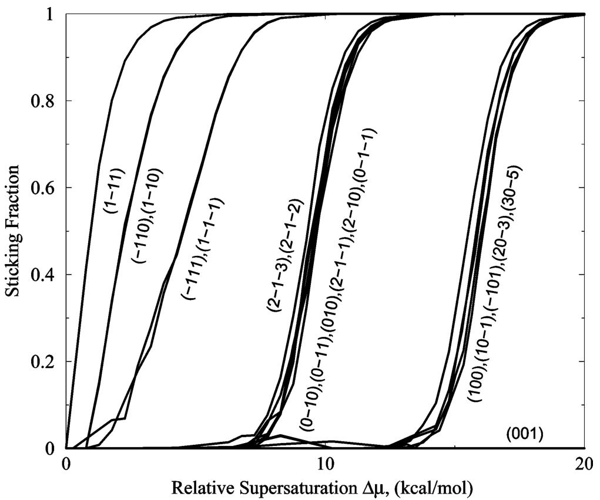
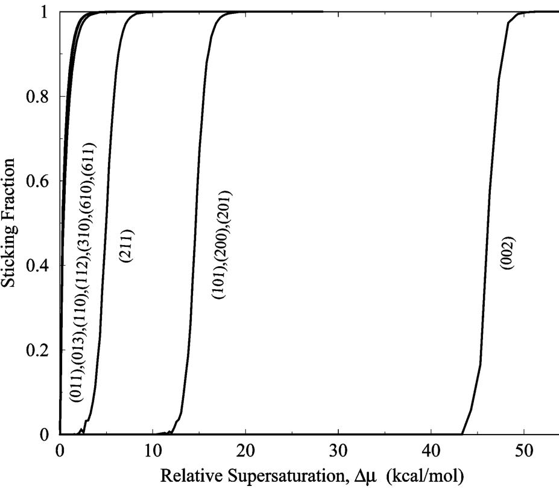
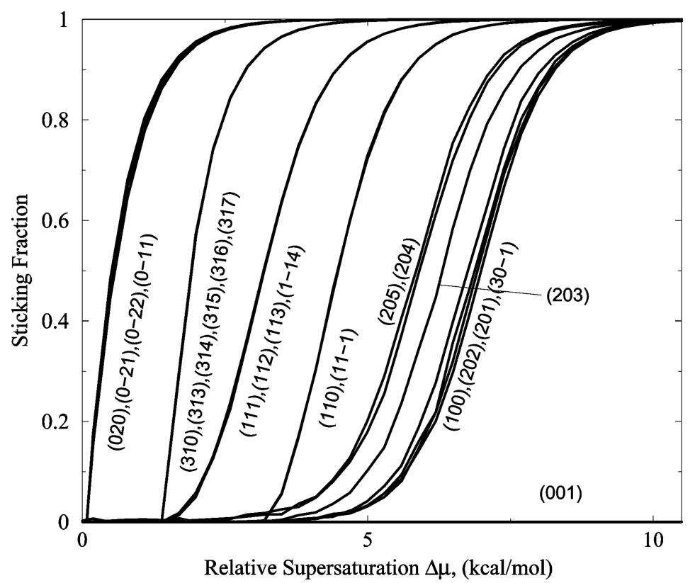

<PAGE>
5894
J. Phys. Chem. A 2004, 108, 5894–5902
MONTY: Monte Carlo Crystal Growth on Any Crystal Structure in Any Crystallographic Orientation; Application to Fats
S. X. M. Boerrigter, \( ^{\dagger} \)  G. P. H. Josten, J. van de Streek, \( ^{\ddagger} \)  F. F. A. Hollander, \( ^{\S} \)  J. Los, H. M. Cuppen, P. Bennema, and H. Meekes \( ^{*} \)
NSRIM Department of Solid State Chemistry, University of Nijmegen, Toernooiveld 1, 6525 ED Nijmegen, The Netherlands
Received: January 14, 2004; In Final Form: May 5, 2004
A versatile crystal-growth simulation program, based on the Monte Carlo algorithm, is introduced. It enables the handling of any crystallographic orientation. The crystal is modeled by a set of molecular interactions, which are obtained from molecular mechanics calculations. The motherphase is parametrized by its bulk thermodynamic properties. As an example, the program was used to simulate the growth of various fat crystals. The results show the importance of the details of the crystal structure, its energetics, and the actual growth conditions upon the crystal morphology. The model intends to fill the gap which exists by the fact that supersaturation, temperature, concentration, and dissolution free energy are not taken into account by the established morphology prediction models.
1. Introduction
Morphology prediction is an important analytical tool in materials science. Various methods exist and are available in commercial software. \( ^{1} \)  These include the geometrically based Bravais–Friedel–Donnay–Harker, \( ^{2,3} \)  the attachment energy based growth morphology, \( ^{4} \)  and the surface energy based equilibrium morphology methods. \( ^{5} \)  These methods produce a static morphology, disregarding the kinetic processes that take place during crystal growth.
Currently, the most successful morphology prediction algorithms usually apply the attachment energy as the growth-controlling parameter. This energy denotes the amount of energy that is lost when a crystal is cut along the plane of a crystallographic orientation. The growth rate of that orientation is presumed to be proportional to its attachment energy. Although this principle works reasonably well for a lot of crystals, many cases are known for which this method of predicting fails. Moreover, it is well known that crystal morphologies are heavily influenced by several physical parameters not reflected by the attachment energy, which can all be translated into the driving force,  \( \Delta u \) , for crystallization, often expressed in terms of the relative supersaturation.  \( \sigma_{s} \)  The parameter that determines the effective driving force depends on the nature of the motherphase, which can be a pure melt, a solution, or the vapor phase (sublimation growth). For growth from a solution, the driving force is determined by the concentration and the temperature. For sublimation growth, the vapor pressure plays the dominant role. In any case, the enthalpy and entropy of the growing species, both in the motherphase and in the crystal, determine  \( \Delta u \) .
Besides these principal parameters, other effects are known to play a role on the growth rates of the crystal face orientations.
These include surface reconstruction, impurities, dislocations, interaction of the solvent with the surface and orientational effects in the solvent–surface interaction layer, \( ^{6} \)  and, especially for vapor growth, surface diffusion. All of these effects have been approached by modeling methods but are out of the scope of this work.
Of the two parameters, enthalpy and entropy, the latter is difficult to calculate, and in chemical modeling, entropy is the archetypal fudge factor for explaining differences between predictions and experiments. In our approach the entropy is a parameter in the model. Experimentally, the entropy can be obtained from solubility data.
In this work, we introduce an energetic model suitable for discrete Monte Carlo crystal growth taking entropy and kinetics (as determined by the driving force) into account. The model is derived to describe a system where growth units (GU) can exist in two phases, the crystal phase and the morphologies. The GUs in the crystal phase can only be in discrete positions as defined by the crystal structure without any imperfections. GUs in the morphosphere are taken into account by their mean thermodynamic bulk terms. In our approach, we do not consider (surface) diffusion- contributions. Such a model has been employed by many authors for relatively simple crystal structures. \( ^{7-11} \)  The crystal model studied mostly up to now is the Kossel model describing a simple cubic crystal. Our authors considered the possibility of a new 'phase transition' and nonther phase for the purpose of the implementation of a program that can deal with any crystal structure growing or etching  \( \mu \)  any: nonther phase. Moreover, for nonphlogy prediction, the implementation should be able to simulate growth in any crystallographic direction in order to obtain the growth rate for all the relevant crystal faces. This paper describes in full detail the thermodynamic model and some of the key technical details used in our implementation, which meet the mentioned objectives resulting in the program MONTY. \( ^{12} \)
MONTY has already been used for various morphology studies including the validation by comparison to earlier Monte Carlo simulations based on the Kossel crystal structure and AB-

* To whom correspondence may be addressed. E-mail: hugom@scik.uni.lu.
\( ^{\dagger} \)  Present address: Department of Industrial & Physical Pharmacy, Purdue University, 575 Stadium Mall Drive, West Lafayette, IN 47907-2991.
\( ^{\ddagger} \)  Present address: Cambridge Crystallographic Data Centre, 12 Union Road, Cambridge, CB2 1EZ, U.K.
\( ^{§} \)  Present address: Friseland Cuberco Dairy Foods, Corporate Research, P.O. Box 87 7400 AB Deventer, The Netherlands.
10.1021/jp049804h CCC: $27.50
© 2004 American Chemical Society
Published on Web 06/11/2004
<PAGE>
Monte Carlo Crystal Growth on Any Crystal Structure
J. Phys. Chem. A, Vol. 108, No. 27, 2004
5895
layered structures \( ^{13} \) and the basic morphology of \( \gamma \)-aluminum-(III) hydroxide. \( ^{14} \) The latter studies were performed in combination with an extended connected net analysis leading to the explicit determination of the relevant edge energies for 2D nucleation, consistent with the Monte Carlo results. The program was also applied successfully to paracetamol in water. \( ^{15} \) Here, we restrict to the validation studies done for three types of fats, crystallizing in different crystal structures. Typically, fats define a class of materials for which the traditional morphology prediction models do not work well. A solid theoretical background is already established and is supported by experimental observations. \( ^{16,17} \)
2. Theory and Implementation of MONTY
2.1. Event Chances. The widely used Monte Carlo algorithm uses the basic principle of sampling a representative part of the phase space of the particular system of interest. Random moves are either accepted or rejected based on a chance that is related to the energy change involved with that move. To be able to simulate a multiphase system, we should consider the Gibbs ensemble, \( ^{18} \)  As is done by many authors, however, we shall impose rigorous simplifications on our model to decrease simulation time and to be able to sample a significant part of phase space, enabling good statistics. Crystal growth phenomena can be reproduced well on a discrete crystal lattice without considering the continuous movements of molecules and atoms, \( ^{7-11} \)  The discrete model implies that growth and etch events can only occur to and from the bulk crystallographic positions without variation of molecular orientations. Also throughout this work, we assume that the simulated systems are sufficiently large to justify the assumption that the bulk phase free energies are constant during the course of the simulation. Our initial mass estimation and the restricted to immediate exchanges of GUs between the crystal phase and the morphase. This restriction defines a semi-Gubs ensemble similar to how the semigrand canonical ensemble is defined in relation to the grand canonical ensemble. \( ^{18} \)  In our ensemble, the exchange of GUs between the bulk phases is determined by the difference in chemical potential,  \( \Delta\mu \) . Hence:
\[
\Delta \mu = \mu^ {\mathrm{mol}} - \mu^ {\mathrm{cryst}} =
\]
\[
\left(\frac {\partial G}{\partial \mu^ {\mathrm{mol}}}\right) _ {\mathrm{P}, \mathrm{T}, \mathrm{N} ^ {\mathrm{cryst}}} = \left(\frac {\partial G}{\partial \mu^ {\mathrm{cryst}}}\right) _ {\mathrm{P}, \mathrm{T}, \mathrm{N} ^ {\mathrm{cryst}}} \tag {1}
\]
where  \( N^{mol} \)  and  \( N^{cryst} \)  are the number of GUs in the motherphase and crystal phase, respectively. In this equation, we neglect the change in total Gibbs free energy G as a result of a change of the interface between the two bulk phases. The Gibbs free energy of the GU in either phase,  \( G^{bcc} \) , is given by
\[
G ^ {\text { phase }} = H ^ {\text { phase }} - T S ^ {\text { phase }} = U ^ {\text { phase }} + P V ^ {\text { phase }} - T S ^ {\text { phase }} \tag {2}
\]
where H is the enthalpy, U is the internal energy, S is the entropy, and V denotes the volume. The temperature,  \( T_{s} \)  and pressure, P, are assumed to be homogeneous throughout the system.
When different components of the crystal are present in the membrane, the free energy for component i is given by
\[
G _ {i} ^ {\text { mth }} = U _ {i} ^ {\text { mth }} + P V _ {i} ^ {\text { mth }} - T S _ {i} ^ {\text { mth }} \tag {3}
\]
This subscripted expression is only needed for cocrystallizing compounds, where the different GBs have different free energies in the motherbase. For simplicity and convenience, these subscripts are further omitted in this work as we will deal with
crystals of pure molecular compounds only. Hence, the following equations in this work only apply to pure crystals that do not include different molecules such as solvent molecules or cocrystallizing compounds. For those types of crystal, the respective individual bulk terms should be adapted in all expressions.
It is important to note that a discrete model for the solid phase implies a discrete number of surface-site configurations which lead to a discrete number of GU configurations. The number of possible configurations of the GUs at the crystal surface is determined by the number of GUs, labeled by 1, in the unit cell and the number of GUs. A more detailed description of the math requirements is given in the discrete model, every GU can form a maximum of 1, bonds, which defines a limited set of molecular interactions, also called the crystal graph, which is further discussed in section 2.4. Each possible state is defined by the combination of the individual states of these bonds, which can either be formed or not, depending on whether the respective neighboring GU is present or not. Therefore the total number of possible states of GU is 2, and the total number of GU configurations, \( N_{\mathrm{GU}} \), becomes
\[
N _ {\text { conf }} = \sum_ {i} 2 ^ {l _ {i}} \tag {4}
\]
including the nonbonded states in the biorthophene. This number defines the maximum number of possible energy states under consideration during the simulation. For a particular state \( j \) of the GU, the short-hand notation \( 2^{j2} \) is used. The energy of that GU in the crystal which is equal to the total interaction energy) with its neighboring GUs is denoted as \( U_{jkl} \).
Generally, the translational and rotational contributions to the entropy are much larger for the motherphase than for the crystal phase. This implies that we can neglect the differences in entropy of the GUs at various sites at the crystal surface. Thus, the entropic part of the free-energy differences between the motherphase and the crystal phase is fully described by the entropy difference between the bulk phases, irrespective of the position of the surface. Accordingly, the difference in Gibbs free energy for an event at a particular surface site i2j with an effective change in thermodynamic energy  \( U_{ij}^{m,effi,j} \)  becomes
\[
\Delta G _ {i 2 j} = \Delta U _ {i 2 j} - T \Delta S + P \Delta V \tag {1}
\]
where
\[
\Delta S = S ^ {\text { mol }} - S ^ {\text { crystall }} \tag {6}
\]
and
\[
\Delta V = V ^ {\text { mol }} - V ^ {\text { cryst }} \tag {7}
\]
In our model,  \( U_{i,j}^{moth,eff.} \)  is assumed to depend linearly on the site energy. Effectively,  \( C_{i,j}^{mol} \)  that matches to the surface loses 3 fraction of its mol/mphase interaction energy, which is proportional to the amount of energy gained at the crystal surface according to
\[
U _ {1 / 2 j} ^ {\text {moth,eff}} = \frac {U _ {1 / 2 j}}{U ^ {\text {cryst}}} U ^ {\text {moth}} \tag {8}
\]
(where  \( U^{moth} \)  is the bulk crystal interaction energy per GL statement)
\[
\Delta U _ {1 / 2 j} = U _ {1 / 2 j} ^ {\text {moth,eff}} - U _ {1 / 2 j} = \left(\frac {U _ {i} ^ {\text {moth}}}{U ^ {\text {cryst}}} - 1\right) U _ {i / 2 j} \tag {19}
\]
<PAGE>
5896
J. Phys. Chem. A, Vol. 108, No. 27, 2004
Boerrigter et al.
If we assume that every growth and etch event is microscopically reversible, \( ^{19} \) we can relate their probabilities by the Boltzmann factor corresponding to the energy difference involved with that event. Hence, by use of eq 5, the expression for the growth and etch probability ratio at the particular crystal site (2) becomes
\[
\frac {P _ {i 2 v} ^ {\text { growth }}}{P _ {i 2 v} ^ {\text { etch }}} = \exp \left(\frac {\Delta G _ {i 2}}{k _ {\mathrm{B}} T}\right) = \exp \left(\frac {\Delta U _ {i 2} - T \Delta S + P \Delta V}{k _ {\mathrm{B}} T}\right) \tag {10}
\]
A thorough statistical thermodynamic basis for the derivation of eq 10 is given in Appendix A. The microscopic equilibrium condition defined by eq 10 is not enough to determine probabilities for the growth and etch events to be used in the Monte Carlo simulation since it only relates the ratio between the chances of growth and etch events. To proceed, various schemes are possible, which can roughly be classified in three classes. The first scheme is that of Metropolis et al. \( ^{20} \) . Here, any event that causes energy to be released is always accepted, whereas trials that cost energy may only happen at a probability determined by the corresponding Boltzmann factor. Another choice for the probabilities. often used in crystal growth simulations, is obtained by assuming a constant flux of GUs arriving at the crystal surface only determined by the driving force. \( ^{7} \)  This implies that every growth trial is accepted with the same probability, independent of the site where it attaches, while detaching is determined by the energetics of the GUs. As less obvious choice would be to assume an equal probability of etching for every GU at the surface, which is typically used for dissolution or etching simulations. \( ^{21,22} \)  In our model, to allow full freedom of choice, we introduce two parameters  \( \lambda_{1} \)  and  \( \lambda_{2} \) . (The site dependence of the probabilities is modeled by  \( \lambda_{1} \) . A site-independent attachment probability is obtained for  \( \lambda_{1}=0 \) , and a site-independent detachment probability for  \( \lambda_{1}=1 \) .) Similar to the case for  \( \lambda_{2}=1 \)  models the UI dependence of the probability. The condition for microscopic reversibility (see eq.10) is maintained for any value of the  \( \lambda_{2} \)  parameters; once outside this range, but this seems a rather unphysical choice. The introduction of the  \( \lambda_{2} \)  parameters results in the following chances for the growth and etch events
\[
P _ {\mathrm{II} 2} ^ {\text { growth }} = \exp (- \beta \lambda_ {1} (\Delta U - \Delta U _ {\mathrm{I} 2}) -
\]
\[
\beta (\lambda_ {2} - 1) (\Delta U - T \Delta S + P \Delta V)) \tag {11}
\]
\[
\begin{array}{l} P _ {\mathrm{I} 2} ^ {\text { etch }} = \exp (- \beta (\lambda_ {1} - 1) (\Delta U - \Delta U _ {2 2}) - \\ \beta \lambda_ {2} (\Delta U - T \Delta S + P \Delta V)) \tag {12} \\ \end{array}
\]
where  \( \beta = (k_{\mathrm{B}}T)^{-1} \)  and the difference in energy of the bulk phases is given by  \( \Delta U = U^{\mathrm{moln}} - U^{\mathrm{cryst}} \) . The relation between the thermodynamic parameters in these expressions and the driving force for crystallization is given by
\[
\Delta \mu = \Delta U - T \Delta S + P \Delta V \tag {12}
\]
The  \( \lambda \)  parameters do not alter the equilibrium condition, which is only determined by the ratio of the probabilities. However, the relative rates of different growth and etch events do change dramatically with varying  \( \lambda \) , ideally, the particular choices of  \( \lambda_{i} \)  should be optimized for the description of the kinetic behavior of the crystal surface in the simulation. A first interpretation of the effect of the variation of  \( \lambda_{i} \)  is given by Cuppen et al. \( ^{23} \)  A further refinement would be to consider separate  \( \lambda_{i,2} \)  terms for each of the exchange states, although then kinetic behavior of all those states should be known.
2.2. Sampling Efficiency. The original, well-known importance sampling algorithm by Metropolis et al. \( ^{29} \) uses the acceptance chance for trials of increasing energy. This sampling method applies an acceptance factor, which results in the rejection of a certain amount of trials during a simulation. Especially at near-equilibrium conditions, this means that a considerable amount of attempts is rejected and therefore this method is not very efficient. A much more efficient sampling method in terms of CPU cycles vs Monte Carlo events can be devised, which accepts every trial. Such a method is found in the so-called n-fold way, which was introduced by Bortz et al. \( ^{24} \) and which has been used by many authors since then. It makes use of the limited number of states of the GUS, as defined by eq.4. The sum of all the probabilities of all the possible events of etching and growth at the surface, \( O_{m} \), is determined at each MC step labeled by n. Events are chosen randomly according to their probabilities from the complete set of possible events and are always accepted. Obviously, a time correction has to be applied, as was also documented by the same authors. They showed that an independent stochastic time increase \( \Delta t_{n} \) at trial n should be taken as
\[
\Delta t _ {n} = - \frac {\tau}{Q _ {n}} \ln R _ {n} \tag {14}
\]
where  \( R_{n} \)  is a random number within the interval  \( (0,1) \)  and  \( \tau \)  is an elementary time scale for the events. The random contribution to the stochastic time increase can, however, be omitted for sufficiently long simulations. Since  \( Q_{n} \)  and  \( R_{n} \)  are not correlated, it holds that the total real time that has passed after  \( N_{MC} \)  events is given by
\[
t _ {N _ {\mathrm{MC}}} = - N _ {\mathrm{MC}} \left\langle \frac {\tau}{Q _ {n}} \ln R _ {n} \right\rangle = - N _ {\mathrm{MC}} \left\langle \frac {\tau}{Q _ {n}} \right\rangle \langle \ln R _ {n} \rangle =
\]
\[
- N _ {\mathrm{MC}} \left\langle \frac {\tau}{Q _ {n}} \right\rangle \int_ {0} ^ {t _ {1}} \ln x \mathrm{d} x = N _ {\mathrm{MC}} \left\langle \frac {\tau}{Q _ {n}} \right\rangle = \sum_ {n = 1} ^ {N _ {\mathrm{MC}}} \frac {\tau}{Q _ {n}} \tag {15}
\]
where  \( N_{MC} \)  is the total number of Monte Carlo events performed during the simulation. The time increase, thus, simplifies to
\[
\Delta t _ {n} = \frac {\tau}{Q _ {n}} \tag {16}
\]
which also circumvents the numerical problems that occur for values of  \( R_{n} \)  close to 0. It should be noted that fluctuations of the growth speed are greatly reduced by this approximation, which we regard as an additional advantage, since this allows shorter simulation times for equally reproducible results.
2.3. Solid-to-Solid Condition. Many discrete Monte Carlo simulations of crystal growth utilize the solid-on-solid (SOS) condition. \( ^{7} \)  This more or less pragmatic condition applied to the Kossel and related models implies that GUs can only attach to the surface at sites for which all the sites below it are occupied. This condition avoids overhangs and inclusions. In the present case, however, the model is abstracted to such an extent that this restriction cannot be applied straightforwardly, as the concept of height is no longer defined. \( ^{8} \)  A more general alternative could be to consider a modified (STS) condition which implies that GUs are merely restricted to attach to the surface, forming at least one bond. Instead of strictly on top of it. This allows for overhangs and inclusions, which can change the growth behavior dramatically but only at very high super saturations. We believe that this approach mimics the growth conditions better. The STS method does not allow the nucleation
<PAGE>
Monte Carlo Crystal Growth on Any Crystal Structure
J. Phys.Chem. A, Vol. 108, No. 27, 2004
5897
of new crystals in the motherphase. This is clearly an artificial condition, since nucleation of new crystals can always occur in experimental conditions with sufficiently high supersaturations but is less relevant for the purpose of morphology prediction. The use of an STS model is convenient, since growth can only take place at the boundary layer; this allows for an implementation of a limited data structure. To maintain equilibrium for  \( \Delta\mu=0 \) , etching of a fully bound (bulk) GU is prohibited as well.
2.4. Parametrization from the Crystal Graph To simulate the growth of a particular crystal face (hk1), periodic boundary conditions have to be applied along the plane directions. However, the use of such 2D periodic boundary conditions for any orientation (hkl) is tedious, since a lot of calculational effort is needed to determine the environment of growth sites at the domain borders, throughout the simulation. In our implementation, the (001) face in the simulation reference frame is taken as the growth direction which is parallel to the reciprocal lattice vector (hkl) of the crystal. Periodic boundary conditions apply along two directions [100] and [010] perpendicular to it. The transformed unit cell is called a slice cell, spanned by new lattice vectors \(\mathbf{n}_{\mathrm{i}}\) and \(\mathbf{w}_{\mathrm{i}}\). The resulting slice cell is chosen to have an identical volume (to enlarge the cell and all angles closest to \(90^{\circ}\). Since the formal space-group information is lost by creating a slice cell, each GU in the slice cell is treated as a unique entity without considering symmetry, without loss of generality. To determine all possible states \(U_{1/2}\), the bond energies are parametrized through a convenient file format (crystal graph format, .cfg) which is also used in our connected net analysis program FACELIFT-2.50® and the structural isotropy analysis program ISOTROPY-0.06-® The crystal graph specifies the energy of the interactions between pairs of GUs. The interaction energy is defined as the energy released by bringing the GUs from infinite distance into their crystallographic positions. This can be calculated as the difference in energy between the pair of GUs at their crystallographic positions and the sum of the intramolecular energies of the individual GUs. Several molecular mechanics programs have been modified to automate the creation of crystal graphs, since obtaining the separate interaction graphs without automation generally requires a lot of manual labor. Among others, these programs include GULP\(^{27}\) (not fully automated yet) and most importantly the open force field implemented in Cerius\(^{21}\), which allows full crystal graph generation through an undocumented call via the command line interface. A computationally effective algorithm is needed to determine the chance for a growth or etch move during the simulation. For this purpose, a lookup table strategy is adopted. The index in the table is determined by the binary representation of the integer number which is created by taking the on/off status of each bond as the respective bits.
2.5. Relation to Experimental Conditions. The driving force  \( \Delta\mu \)  for crystallization is defined by
\[
\frac {\Delta \mu}{k _ {\mathrm{B}} T} = \ln \frac {a}{a _ {\mathrm{eq}}} \tag {17}
\]
where a is the activity of the GUs in the motherphase. For crystal growth from ideal solutions, the activity can be replaced by the mole fraction x of the GUs. If the ratio  \( x/\Delta_{eq} \)  is close to unity we can approximate eq 17 as
\[
\frac {\Delta \mu}{k _ {\mathrm{B}} T} \approx \ln \frac {x}{x _ {\mathrm{eq}}} \approx \frac {x - x _ {\mathrm{eq}}}{x _ {\mathrm{eq}}} \equiv \sigma \tag {18}
\]
where \(\sigma\) is the relative supersaturation and \(x_{\mathrm{eq}}\) is the equilibrium
mole fraction. Both  \( \sigma \)  and  \( \Delta\mu \)  are commonly used to parameterize the crystal. Growth experiments and simulations The relation between the experimentally relevant parameters in our model,  \( U_{g2} \) ,  \( U^{mod} \) ,  \( \Delta S \) , and  \( \Delta V \)  and the driving force  \( \Delta\mu/k_{B}T \)  will be discussed.
From eqs 11 and 12, it can be seen that, given the values for \( U_{f2} \), the growth behavior of a crystal can be simulated as a function of any of the thermodynamic parameters temperature, motherphase energy, and entropy. Moreover, the kinetic behavior can be tuned by changing \( \lambda_i \). \( U_{f2} \) can be calculated from molecular mechanics force fields, as explained in section 2.4. The motherphase could be modeled using a similar approach, but experimental data can also be used. For growth from a solvent, for instance, the dissolution enthalpy and entropy can be derived from solubility data. (The symbols: \( \lambda_0 \) is related to the dissolution Gibbs energy according to
\[
\ln x _ {\mathrm{eq}} = - \frac {\Delta G ^ {\text { diss }}}{R T} = - \frac {\Delta H ^ {\text { diss }}}{R T} + \frac {\Delta S ^ {\text { diss }}}{R} \tag {19}
\]
but more sophisticated methods such as the expanded Hansen approach (ref 28 and references therein) may also be used. Crystal growth can be achieved by changing the appropriate parameters of a system as compared to equilibrium (for which \(\Delta\mu=0\)), like lowering the temperature, increasing the pressure, increasing the solute concentration (i.e., lowering the entropy), or lowering the thermophase interaction energy \(U^{mol}\). The latter can only be achieved experimentally by changing the solvent. A change of any of these parameters changes the driving force for crystallization \(\Delta\mu\) according to eq 13. Thus, our approach allows for the simulation of several kinds of experimental conditions in a direct way.
2.6. Interpretation of Simulation Results. The linear growth rate of trace MAB is determined by
\[
R _ {h k l} = \frac {d _ {h k l} N _ {\text { growth }}}{N _ {\text { slice }}} \frac {- N _ {\text { etch }}}{t _ {N _ {\text { mic }}}} \tag {20}
\]
where  \( d_{hkl} \)  is the interpolant distance between growth slices  \( N_{macro} \)  and  \( N_{slice} \)  are the total number of growth and etch events during the simulation, and  \( N_{slice} \)  is the total number of GUs in the growth slice. The total simulation time  \( t_{N_{slice}} \)  passed after  \( N_{slice} \)  events is found by adding the individual event time intervals as defined in eq 16
\[
t _ {N _ {s u c}} = \sum_ {n} ^ {N _ {s u c}} \Delta t _ {n} = \sum_ {n} ^ {N _ {s u c}} \frac {\tau}{Q _ {n}} = N _ {M C} \langle \Delta t \rangle \tag {21}
\]
where  \( \langle\Delta t\rangle \)  is the average time interval between two consecutive (growth or etch) events. Although  \( \tau \)  may depend on the orientation (bl), we neglect this dependence. The crystal holographic prefactor  \( d_{HI}/N_{MC} \)  in eq 20 ensures that the growth rate is independent of the 2D area of the simulation surface. In the most recent versions of MONTY, the spiral growth mechanism is also implemented. \( ^{15} \)  Currently, this enlarges the computational load considerably.
In the present approach, growth on defect-free crystal surfaces is simulated, allowing only 2D nucleation. The particular property of interest is the barrier for 2D nucleation. From this barrier, the effective-edge free energy, \(\gamma\), can be determined, which can be utilized to estimate the growth speed of a face as a function of the supersaturation based on the classical analytical expressions for the growth speed\(^{16}\) for any growth mechanism that is determined by this edge free energy. For the determination
<PAGE>
5898
J. Phys. Chem. A, Vol. 108, No. 27, 2004
Boerrigter et al.

Figure 1. Schematic overview of experimental (bottom) and calculated (top) attachment energy morphologies from left to right: \(\beta\)-16,16,16, \(\beta''\)-10,12,10, and \(\beta''\)-16,16,14. The indices \(l\) of the experimental crystals could not be determined because the crystals are extremely thin. The difference in attachment energies between visible faces never exceeds a factor of 25. On the other hand, the aspect ratio of the experimental plank-shaped crystals can have values up to length- width-thickness \(= 1000\); column 7, except for the右手most crystal, which is mainly bound by the \(\{11l\}\) form causing a lozenge shape. The small seemingly top facet on the lower side of that crystal is due to accidental damage.\(^{17}\) The \(\{211\}\) faces on \(\beta'\)-10.12.00 line found only at the lowest supersaturations. Usually these faces require causing the slightly exaggerated dotted shape.\(^{18}\) The \(00l\) faces will be designated as basal faces, the \(h0l\) (\(h \neq 0\)) faces as side faces, and the other faces as top faces. The indices differ somewhat from the ones in ref 17 as the later ones are based on a full connected net analysis and the present ones are determined by the attachment-energy module in the Cerius\(^{9}\) package.
of the effective nucleation barrier, we have to determine at which conditions the surface starts to grow in a rough fashion. This can be achieved by plotting the sticking fraction,  \( S_{disl} \) , against  \( \Delta\mu \) . Traditionally, in the random rain model ( \( \lambda_{1} = \lambda_{2} = 0 \) ) for growing crystals ( \( \Delta\mu > 0 \) ), the sticking fraction is defined as
\[
S _ {h k l} = \frac {N _ {\text { growth }} - N _ {\text { etch }}}{N _ {\text { growth }}} \tag {22}
\]
Typically, for growth strongly limited by the 2D-nucleation mechanism, the sticking fraction as a function of the driving force shows an S-like shape, where the roughening transition is marked by a sudden increase from 0 to 1 in the sticking fraction for a certain \(\Delta\mu > 0\). In Appendix B, an expression for the growth rate in terms of the sticking fraction is derived.
As already stated, for growth rate vs driving force curves, the  \( \lambda \)  parameters, should be chosen to mimic the actual growth kinetics. The morphology of a crystal could then ultimately be obtained directly, by measuring the growth rates of all the relevant crystal faces, according to eq 20. It can be shown, that the most efficient sampling is achieved for  \( \lambda_{1} = \lambda_{2} = 0.5 \)  to determine the roughening transition. In this work, we therefore apply those values and stick to the measure given by eq 22.
3. Validation Simulations
3.1. Morphology of Crystals of Three Different Fats. The crystal morphologies of various classes of pure fat compounds were studied in recent work based on a connected net analysis. \( ^{[16,30,31,32,17]} \)  The results of these studies will be validated using the results of our Monte Carlo approach. Traditional morphology prediction models already showed considerable deviations from the experimental morphologies for all these classes of fat crystals. \( ^{[17]} \)  Figure 1 shows the differences between the experimental morphologies and the “growth morphology” as calculated with default settings in Cerius \( ^{21} \) , with a limited “Bond-Energy List”, which was necessary to complete the calculation within a reasonable amount of time. Hollander et al. \( ^{[16]} \)  showed that a
much better agreement between theory and experiment is obtained by calculating the edge free energies of the various faces based on an analysis of their connected nets. Many of the occurring faces with high indices prove not to be connected and are thus nonflat faces. For the details of a connected net analysis, we refer to Grimbergen et al. \( ^{33} \)  The results suggest that the use of the attachment energy as the growth-controlling parameter is not always valid, as was shown in more detail for one of the fats considered here by Boerrigter et al. \( ^{34} \)  and reconsidered in a subsequent paper. \( ^{17} \)  In the latter paper, the morphology for each of the three classes of fats treated here was explained in detail on the basis of a connected net analysis and edge energy analysis.
The crystal structures of the pure fats under study are representatives of three different classes of homologously isomorphs for that structures with varying fatty acid chain lengths, indicated by the number of carbon atoms in the chain, n. These classes are the  \( \beta-C_{n}C_{m}C_{n'} \) ,  \( \beta'-C_{n}C_{m+2}C_{n'} \) , and  \( \beta'-C_{n}C_{m}C_{m'-2} \)  triacylglycerols, where n is always even and for which the short notations  \( \beta-n.n.n \) , etc., are further used. In order of chronological appearance, the crystal structures for  \( \beta \) -16.16.16 (space group  \( P1)^{35} \)  and for  \( \beta' \) -10.12.10 (space group  \( I_{c}2a)^{36} \)  were determined by Van Langevelde et al. and that of  \( \beta' \) -16.16.14 (spacegroup  \( C2)^{37} \)  was elucidated by Sato et al.
The crystallographic data of these structures were used for the molecular mechanics calculations as follows. The energies of all fats were minimized using the consistent valence force field (CVFF), \( ^{38} \) using the “smart minimizer” of Cerius \( ^{39} \). \( ^{39} \) Ewald summation was used for both the van der Waals interactions and the Coulomb interaction, with the accuracy set to \( 1 \times 10^{-4} \) kcal/mol. The convergence was set to RMS force = \( 1.0 \times 10^{-3} \) kcal/mol \( \AA \), max force = \( 5.0 \times 10^{-3} \) kcal/mol \( \AA \), \( \Delta E = 1.0 \times 10^{-4} \) kcal/mol, RMS displacement = \( 1.0 \times 10^{-5} \) \( \AA \), max displacement = \( 5.0 \times 10^{-5} \) \( \AA \), RMS stress = \( 1.0 \times 10^{-3} \) GPa, max stress = \( 5.0 \times 10^{-3} \) GPa (the “high convergence” option in Cerius \( ^{2} \)). Van de Streek et al. successfully used these settings to predict the crystal structure of \( \beta 2-10.12.10.^{40,41} \) The molecular interactions (see section 2.4) were calculated by using the open force field of Cerius \( ^{2} \) resulting in the crystal graphs. The specific numerical results as well as a full extended connected net analysis can be found in refs 16 and 17.
The connected net analysis provides a selection of faces that are most likely to appear on the morphology of the crystals. All those faces found were simulated using MONTY 0.963 and 0.975 as well as some additional nonflat faces with small indices. The latter nonflat faces were considered to test whether such faces indeed grow already rough at very small driving forces. For the \(\beta^{*}\) structures, the surfaces consisted of \(50 \times 50\) slice cells. Each data point was obtained after an equilibration stage of 200 000 Monte Carlo events followed by a total of 1 000 000 events in the sampling stage. A temperature of \(300\mathrm{K}\) was used. The \(\beta\) crystal was simulated with the following values for the respective parameters: \(40 \times 40\) slice cells, 100 000 relaxation events, 100 000 sampling events, and \(313\mathrm{K}\). No solvent interaction energy data were available; hence a value for \(U_{molb}\) of 0 was taken for the simulation. This will certainly influence the absolute values of the edge free energies but is expected to have a negligible effect on their relative values. The use of the parameter \(U_{molb}\) was already successfully demonstrated in the case of paracetamol.[15] Furthermore, \(\Delta V\) was taken as 0, which is assumed to be a good approximation for growth from solvents. In all simulations, the efficient sampling technique was used where the kinetic parameters were set to \(\lambda_1 = \lambda_2 = 0.5\). The
<PAGE>
Monte Carlo Crystal Growth on Any Crystal Structure
J. Phys. Chem. A, Vol. 108, No. 27, 2004
5899

Figure 2. Sticking fraction of various faces of  \( \beta \) -16.1.6.16. The roughening transition of the (001) face is out of the range of this graph at about 60 kcal/mol.

Figure 3.  \( \beta^{*} \) -10.12.10 shows very few orientations which do not grow rough at low supersaturation.
effective supersaturation was, thus, only varied by variation of the entropy, i.e., the concentration in the solution.
3.2. Results and Discussion. We will make a distinction between basal, side, and top faces as indicated in the caption to Figure 1. Figures 2–4 show the typical S-shaped growth rate curves obtained from the simulations for various crystal faces as a function of the supersaturation. These curves show the driving force needed for unhindered growth as a pronounced onset of the sticking fraction. For values below this threshold supersaturation, which depends on the edge free energy, 2D nuclei cannot reach the critical size. Effectively, the surface does not grow, and thus, the sticking fraction is zero. At the onset of the S-curve, occasionally, a 2D nucleus can reach the critical size. Here, the surface is growing slowly by the 2D nucleation mechanism. At increasing supersaturation, the size of the critical nucleus decreases, which causes the sticking fraction to increase gradually. At supersaturations above the threshold, the size of the critical nucleus is sufficiently small to allow unhindered growth. There, the edge free energy becomes equal to zero. Note that a zero edge free energy in a single direction along the face is already enough for a face to roughen. \( ^{16,17} \)  The transition is interpreted as the kinetic roughening transition.

Figure 4.  \( \beta' \) -16.16.14. Apart from (001), most faces roughen at a relatively low supersaturation, close to each other, suggesting a relatively isotropic morphology. (001) roughens at 62 kcal/mol.
All three structures show groups of growth curves of different faces which have an identical growth behavior. The responsible edge direction, in most cases, is shared among the group members. Hence, they start to grow at roughly the same supersaturation.
Several opposite faces on the  \( \beta \) -16,16.16 crystal, which has inversion symmetry, were simulated to check the consistency. In the relevant space group P1, opposite faces belong to the same form (set of symmetry related faces) and must, therefore, show exactly the same curve. This is indeed observed.
The shorter simulations on the  \( \beta \)  crystal occasionally show typical bumps before the onset of the curve. Later work has shown that this is not a significant peculiarity of the growth behavior. It is rather a result of the fact that the growth mechanism is controlled by a strict layer-by-layer mechanism. Since the 2D nuclei only reach their critical size yet occasionally at low  \( \Delta\mu \) , longer sampling times are needed to obtain a smaller standard deviation of the sticking fraction. The curves of the  \( \beta' \)  simulations, obtained for a much longer sampling time, are much smoother at a low sticking fraction.
All structures have heavily retarded (001) orientations. The enormous supersaturations needed to initiate 2D nucleation show that these faces are very unlikely to grow via this mechanism under any experimental condition. This was indeed observed as these faces seem to grow invariably via the spiral growth mechanism while for the top and side faces spirals are expected to grow out of the very thin faces and, therefore, to grow via a 2D nucleation mechanism. \( ^{31} \)  The attachment energy prediction is in agreement with these results. The side  \( \{h0l\} \)  and top  \( \{hkl\} \)  faces determine the different morphologies and, especially, the aspect ratios for the various crystal structures. These will be discussed separately for the three examples studied.
3.2.1.  \( \beta \) -16.16.16. For  \( \beta \) -16.16.16 (Figure 2), there are four groups of curves. The first group consists of forms of faces that grow roughly at a very small supersaturation:  \( \{1\bar{1}1\} \) ,  \( \{1\bar{1}0\} \) , and  \( \{111\} \) . The curves for opposite faces of these forms coincide up to statistical fluctuations. None of these orientations was found to be connected nor observed experimentally. \( ^{16} \)  This confirms the expected behavior regarding the roughening theory. However, exceptions are found in the nonconnected net orientations ( \( \bar{2}13 \) ) and ( \( 2\bar{1}2 \) ), which appear on the left-hand side of the second and largest group of curves that become rough at about 7 kcal/mol. Their sticking fraction profiles are nearly
<PAGE>
5900
J. Phys. Chem. A, Vol. 108, No. 27, 2004
Boerrigter et al.
identical to those of the other members of that group, which are exactly the weakly connected top faces appearing on the experimental crystals. The sticking fractions of  \( (21\bar{3}) \)  and  \( (2\bar{1}2) \)  suggest that these faces are stable and stay flat. However, close examination of the resulting surfaces showed that these faces rapidly form a sort of roof-like pattern constrained by the size of the simulation box during the equilibration phase. The roofs were truncated by  \( \{001\} \)  and  \( \{2\bar{1}1\} \)  faces. This roof pattern, therefore, grows at the rate of the fastest of the two, therefore showing a nearly identical roughening behavior as the  \( (2\bar{1}1) \)  face. This means that the macroscopic crystals will not show the  \( (2\bar{1}3) \)  and  \( (2\bar{1}2) \)  faces but rather the  \( (001) \)  and  \( (2\bar{1}\bar{1}) \) . Since the third index could not be determined experimentally, all the remaining faces in the second group of Figure 2 can indeed be present on the experimental morphology. The third group at about 13 kcal/mol concerns exclusively the side faces, and finally we find the extremely stable basal faces  \( \{001\} \)  at about 60 kcal/mol.
Summarizing, we can say that the simulation results correspond perfectly to the experimental results in terms of the order of the curves. The attachment energy method, on the other hand, produces the never-observed faces  \( (2\bar{1}\bar{3}) \)  and  \( (1\bar{1}1\bar{1}) \)  as the top faces (see Figure 1). This is clearly inconsistent with both the experimental and simulation results. The simulations show the  \( \{1\bar{1}\bar{1}\} \)  faces to be rough and the  \( \{2\bar{1}\bar{3}\} \)  faces to develop into two different flat faces. The sides of the crystals are predicted to be truncated by the  \( \{203\} \)  and  \( \{305\} \)  forms. These forms, however, show a similar behavior as (213). They are highly unlikely to be present on the experimental crystals because of this breaking-up and since both the extended connected net theory combined with the determination of Ising temperatures \( ^{16,17} \)  and our Monte Carlo simulations produce the  \( \{100\} \)  and  \( \{10\bar{1}\} \)  forms.
3.2.2. \(\beta^{\prime}\)-10.12.10. \(\beta^{\prime}\)-10.12.10 is the most simple one of the three structures considered. Figure 3 shows that the side faces (101), (200), and (201) start to grow at a supersaturation of about \(12\mathrm{kcal / mol}\). Only the first two are connected. Given that these equal growth rates, the crystal is truncated by the (200) face. The attachment energy prediction produces the \(\{101\}\) faces. Since the inclination of the side face could not be determined experimentally, both are still possible. Hence, for the side faces, there is no disagreement between the calculated and experimental crystals. The top faces, on the other hand, do show a striking disagreement between the attachment energy prediction and the simulation results. Flat-top faces were only found for growth from dodecane at low supersaturation and were indexed as \(\{211\}\). For higher supersaturations, they typically grow rough, with diffusion limitation leading to dagger-shaped faces (see also Figure 1). At the onset of diffusion-limited growth, they could erroneously be indexed as (61).\(^{32}\) This is in perfect agreement with the simulation results; the only orientations left which do not grow rough immediately indeed belong to the \(\{211\}\) form. However, the face (211) starts to form 2D nuclei at a supersaturation as low as \(2\mathrm{kcal / mol}\), which indicates that it is expected to go roughly easily. \(\{112\}\) is calculated to be the appearing face on the basis of the attachment energy. The Hartman-Perdok theory agrees with this as this face has a connected net. A first analysis of 2D-nucleation on this face, nevertheless, erroneously resulted in a zero value for the edge energy, corresponding to a rough face.\(^{34}\) However, a detailed study of this top face, published earlier, showed that, in accordance with the presence of a connected net, its edge energy is not zero but small.\(^{17}\) A rough estimate based on this detailed analysis leads to an edge energy for 2D nucleation which is
about 10 times as small as compared to the  \( \{211\} \)  form, resulting in a face that roughens at supersaturations close to zero beyond the precision of our simulations. This explains why the only top faces ever observed as flat faces belong to the  \( \{211\} \)  form. All these results agree perfectly with the simulation results, which show that all other top-face orientations indeed grow rough immediately, including the  \( \{112\} \) . To test the rough growth for the nonconnected (61/) faces, the (610) and (611) faces were added to the simulations; they both showed to roughen already for the lowest supersaturations. This confirms that the apparent faces with tentative indices (61/) at the onset of diffusion-limited growth indeed cannot be attributed to flat faces.
Finally, the (002) basal faces show an onset for 2D nucleation at roughly 43 kcal/mol. If we use the onset of the sticking fraction curves as a semiquantitative measure for the growth rate of the various flat faces, we can compare the aspect ratios of the \(\beta\)-16.16.16 and the \(\beta'\)-10.12.10 crystals. If we compare the side and basal faces, we find a ratio of 13:60 for the \(\beta\)-16.16.16 and 12:43 for the \(\beta'\)-10.12.10 crystals. This is in agreement with the more planklike shape of the \(\beta\)-16.16.16 crystals. By comparison of the top and side faces, we find a ratio of 7:13 for the \(\beta\)-16.16 and 2:12 for the \(\beta'\)-10.12.10 crystals. This explains the far more elongated needle-shaped crystals of the \(\beta'\)-10.12.10 crystals.
3.2.3. \(\beta^{\prime}\)-16.16.14. Figure 4 shows for \(\beta^{\prime}\)-16.16.14 a completely different behavior compared to the other two structures. The {001} basal faces are, still, by far the most stable faces resulting in a flat crystal morphology. All side and top faces, however, have a kinetic roughening transition already in a relatively small range of supertranslations. This suggests that these crystals can only be obtained completely face at a much smaller separation than the other two. The relatively small difference in supersaturation for the onset of roughening between the side faces and the most stable top faces corresponds well to the fact that the experimental morphology of these crystals is that of a lozenge instead of a flank. The attachment-energy morphology shows {602} side faces, which are somewhat larger than the {110} top faces. On the experimental morphology, the top faces {111} are the most prominent while the {101} side faces are just discernible. As mentioned before, the top face at the bottom side of the figure is an experimental artifact. Therefore, the indices predicted by the attachment energy method do not conflict with the experimental morphology, although the aspect ratio is wrong. The simulation results describe the experimental morphology better. At first sight, the {301} face appears to be one of the most stable orientations in accordance with the attachment energy prediction. Closer inspection, however, shows that all side faces (\(k = 0\)) start growing slowly already below the onset of the [110] and [111] top faces. The onset of these top faces is well defined, showing no growth below the threshold supersaturation. This results in a crossing of growth curves. Therefore, for supersaturations smaller than the onset of the top faces, the crystal will be truncated by these top faces and above that onset by the side faces. The experimental morphology of Figure 1 seems to be grown near the transition point. The cause for the unusual slow onset of the side faces remains to be explained.
4. Conclusion
The results of our Monte Carlo approach applied to predict the morphology of fat crystals confirm previous results based on an extended connected net analysis including the determination of edge energies perfectly. Caution should, however, be
<PAGE>
Monte Carlo Crystal Growth on Any Crystal Structure
J. Phys. Chem. A, Vol. 108, No. 27, 2004
5901
taken as the results showed that the sticking fraction is not always conclusive. Some faces break up in other flat-face orientations. Besides the sticking fraction, this breaking up should be taken into account for the proper prediction of the growth behavior of a crystal face. In the present version of MONTY, this demands for an interpretation of both the growth curves and the resulting surfaces.
The implementation of MONTY used in this study simulates growth via the 2D nucleation mechanism for which the edge energies determine the onset of the growth-rate curves. Since crystal faces very often grow via the spiral-growth mechanism, the results cannot be used directly for the purpose of morphology prediction in dependence of supersaturation in general. For this, the actual growth rates of all the relevant faces need to be calculated for a range of supersaturations taking into account this alternative mechanism. This was done for the case of paracetamol where the relevant growth mechanism was determined experimentally for each face. \( ^{15} \)  As was mentioned for the fat crystals, only the basal faces are growing via a spiral-growth mechanism, implying that the aspect ratio between the side and top faces is determined only by the 2D nucleation mechanism.
Even when the growth mechanisms of the various faces are known, the force fields used to determine the bond energies can lead to rather different results as was studied by Cuppen et al. \( ^{42} \)
Other improvements to the method may be needed to increase the predictive value of the method. The simplified assumption of a linear interaction law of the growth units with the solvent, for example, may be considerably improved by calculating surface site specific solvent interactions. Furthermore, an improved kinetic Monte Carlo method could be designed by including the individual transition states. \( ^{43-47} \)  Related to this is a proper choice of the values of  \( \lambda_{i} \)  in eqs 11 and 12. A first interpretation of such a choice was discussed in ref 23. Also, in contrast to some other Monte Carlo methods, no surface diffusion, which is known to be nonnegligible for vapor growth, is taken into account. These issues are left for further research.
Even with these shortcomings, a good correlation between the experimental results is obtained, at least for the cases of the fat crystals considered here and for other examples referred to. This suggests that the main trends are already represented well by the current method. In any case, the results show that, by using MONTY based on the interaction energies between the GUs in the crystal, a crystal morphology in dependence of supersaturation is obtained that is a considerable improvement of the plain attachment energy approach.
Appendix A
An alternative statistical mechanical approach can be used to derive the probability ratio of eq. 10. In the grand canonical ensemble, for a one-component system, the standard expression for the probability for finding a system of \(N\) particles in a state \(\left|^8\right|\) is
\[
P (N _ {d}) = \frac {\exp (- \beta (E (j , N) - \mu N))}{\Xi} \tag {23}
\]
where \(\Xi\) is the grand canonical partition function.\(^{19}\) This can be extended to the probability of finding a system with \(N_{c}\) GUs in the crystal phase and \(N_{m}\) in the methoprene in a state with a surface configuration \(S_{j}\) with a surface energy \(U(S_{d}N_{a}N_{m})\).
\[
P (N _ {c} ^ {j}, N _ {m} | j) = \frac {\exp (- \beta U (S _ {d} N _ {a} N _ {m}) + \beta \mu_ {c} N _ {c} + \beta \mu_ {m} N _ {m})}{\Xi} \tag {24}
\]
The lowest energy level  \( U(S_{0},N_{a},N_{m}) \)  corresponds to the most stable, usually flat, interface with  \( N_{c} \)  solid and  \( N_{m} \)  motherphase GUs. Assuming microscopic reversibility, the probability ratio for attachment and detachment for site i2' becomes
\[
\frac {P _ {i 2 ^ {\prime}} ^ {\text { growth }}}{P _ {i 2 \prime} ^ {\text { etch }}} = \exp (\beta (\Delta U _ {i 2 \prime} ^ {\text { graft }} - \Delta U) + \beta \Delta \mu) \tag {25}
\]
where  \( \Delta\mu = \mu^{much} - \mu^{cryst} \) . Again, we assume a linear dependence for the surface–solvent interaction, which in this approach varies by the complementary energy of  \( U_{i2'} \) . Thus
\[
\Delta U _ {i 2 ^ {\prime}} ^ {\text { graft }} = \left(\frac {U _ {i} ^ {\text { mouth }}}{U ^ {\text { cryst }}} - 1\right) U _ {i / 2 ^ {\prime}} \tag {26}
\]
which defines the effective energy change of the GU at the surface site i2', equivalent to eq 9. Since
\[
\Delta \mu = G ^ {\text { mouth }} - G ^ {\text { cryst }} = \Delta U - T \Delta S + P \Delta V \tag {27}
\]
we obtain after substitution in eq 25 exactly the result given by eq 10.
Appendix B
Equation 20 gives the growth rate of a face (hkl) applicable to any kinetic mechanism as parametrized by the parameters \(\lambda_{i}\) in eqs 11 and 12. Here, we derive a relation between the growth rate and the traditional sticking fraction given by eq 22 which, in principle, is only relevant for \(\lambda_{1} = \lambda_{2} = 0\) and growth situations (\(\Delta \mu > 0\)).
Starting from equation 20, the total simulation time  \( t_{Nuc} \)  can also be expressed in terms of the average time interval between two attachments,  \( \langle\Delta t_{growth}\rangle \) . For that, we determine the total average event frequency as  \( \langle\nu\rangle=\langle\nu_{growth}\rangle+\langle\nu_{cely}\rangle \) . For the individual average frequencies, we find  \( \langle\nu_{growth}\rangle=\langle N_{growth}/N_{MC}\rangle-\langle\nu\rangle \)  and  \( \langle\nu_{cely}\rangle=\langle N_{cely}/N_{MC}\rangle\langle\nu\rangle \)  or equivalently
\[
\langle \Delta t \rangle = \frac {N _ {\text { growth }}}{N _ {\mathrm{MC}}} \langle \Delta t _ {\text { growth }} \rangle = \frac {N _ {\text { etch }}}{N _ {\mathrm{MC}}} \langle \Delta t _ {\text { etch }} \rangle \tag {28}
\]
in terms of the individual average time intervals for growth and etch events, respectively. Substitution into eq 20 yields for the growth rate
\[
R _ {b l d} = \frac {d _ {b l d}}{N _ {\text { slice }}} \frac {N _ {\text { growth }} - N _ {\text { etch }}}{N _ {\text { growth }} \left\langle \Delta t _ {\text { growth }} \right\rangle} = \frac {d _ {b l d}}{N _ {\text { slice }}} S _ {b l d} \frac {1}{\left\langle \Delta t _ {\text { growth }} \right\rangle} \tag {29}
\]
\(\langle \Delta t_{growth}\rangle\) follows from eq 16 and eqs 11 and 12 for \(\lambda_1 = \lambda_2 = 0\)
\[
\left\langle \Delta t _ {\text {growth}} \right\rangle = \frac {1}{\left\langle v _ {\text {growth}} \right\rangle} = \frac {\tau}{\left\langle \sum_ {n = 0} P _ {2 n} ^ {\text {growth}} \right\rangle} = \frac {\tau}{\left\langle N _ {\text {growable}} \right\rangle} = \frac {\tau}{\exp (\beta \Delta t)} \tag {30}
\]
where  \( \langle N_{growable}\rangle \)  is the average number of sites at the surface where a GU can attach. This results in the growth rate expression
\[
R _ {b k l} = \tau^ {- 1} t _ {b k l} \frac {\left\langle N _ {\text {growable}} \right\rangle}{N _ {\text {slice}}} S _ {b k l} \exp (\beta \Delta \mu) \tag {31}
\]
The number  \( \langle N_{growable}\rangle \)  depends on the roughness of the face (hkl) at the driving force  \( \Delta\mu \)  and temperature  \( \beta = 1/kT \) . Thus, more rough faces tend to grow faster. This expression is more complicated as compared to the expression traditionally used
<PAGE>
5902
J. Phys. Chem. A, Vol. 108, No. 27, 2004
Boerrigter et al.
for MC simulations on the Kossel–SOS model. For this latter model, the SOS condition reduces  \( \langle N_{growable}\rangle \)  to  \( \langle N_{growable}\rangle = \langle N_{kinder}\rangle \) . For Kossel-like SOS models, where the growth layer consists of more than one layer of GUs,  \( \langle N_{growthable}\rangle \)  reduces to  \( \langle N_{growthable}\rangle = (1/m)\Delta V_{disc} \) , where m is the number of layers in the slice. In the present approach, however, the SOS condition is replaced by the STS condition demanding for the more general expression for the growth rate given by eq 20, which is applicable to any crystal structure and any value  \( 0 \leq \lambda_{i} \leq 1 \) .
Acknowledgment. This research was supported financially by Organon, N.V. through the Council for Chemical Sciences of The Netherlands Organization for Scientific Research (CwNWO), in the framework of the PPM/CMCS crystallization project.
References and Notes

(1) Cerisa' User Guide, June 2000, version 4.2; Molecular Simulations II Inc.: San Diego, 2000.
(2) Domany, J. D. H.; Harker, D. M. Mineral. 1977, 32, 446.
(3) Domany, J. D. H.; Domany, G. C. R. Acad. Sci. Paris 1961, 252, 908.
(4) Hartman, P.; Bennema, P. J. Cryst. Growth 1980, 49, 145.
(5) Kern, R. Morphology of Crystals; Sunagawa, I., Ed.; Materials Science of Minerals and Rocks Part A; Terra Scientific Publishing company (TERRA; Pulpwy, 1987) 77–206.
(6) Liu, X. Y.; Boek, E. S.; Brise, V. J.; Bennema, P. Nature 1995, 374, 342.
(7) Gilmer, G. H.; Bennema, J. P. Appl. Phys. 1972, 43, 1347.
(8) Bennema, P.; van der Eezer, J. P. Morphology of Crystals; Sunagawa, I., Ed.; Materials Science of Minerals and Rocks Part A; Terra numbersaplenty Publishers company (TERAPUBL), 63; Jpn. J. Appl. Cryst. 1970, 1987; pp 1–75.
(9) Mazzocca, G.; Big, J.e; Fox, H.A.; C. Tostiut, E. Phys. Rev. B 1994, 49, 7625.
(10) Kotra, M.; Levi, A. C. Surf. Sci. 1994, 317, 183.
(11) Woodraska, D. L.; Jaszczak, J. A. Surf. Sci. 1997, 374, 319.
(12) Boerrigter, S. X. M.; Josten, G. P. H.; Meekes, H. MONTY-0.976, Monte Carlo on any Crystal Surface: Department of Solid State Chemistry, University of Nijmegen, 2001; e-mail: mugen@uni-koi.nl.
(13) Grimbergen, R. F. P.; Benemata, P.; Meekes, H. Acta Crystallogr. A 1999, 55, 84.
(14) Svensson, C.; Boerrigsen, S. C.; Grimbergen, R. F. P.; Meekes, P. H.; Fleming, S.; Hiralal, I. D. K.; Rijkeboer, A. J. Phys. Chem. B 2002, 106, 5 004.
(15) Boerrigten, S. X. M.; Cuppen, H. M.; Ristic, R. I.; Sherwood, J. N.; Bennema, P.; Meekes, K. Cryst. Growth Des. 2002, 2 (5), 357.
(16) Hollander, F. F. A.; Boerrigter, S. X. M.; van de Streek, J.; Grimbergen, R. F. P.; Meekes, H.; Bennema, P. J. Phys. Chem. B 1999, 103, 8301.
(17) Hollander, F. F. A.; Boerrigter, S. X. M.; van de Streek, J.; Bennema, P.; Meekes, H.; Yano, J.; Sato, K., J. Phys. Chem. B 2003, 107, 5680.
(18) Frenkel, D.; Smit, B. Understanding Molecular Simulations; Academic Press: San Diego, CA, 1996.
(19) Bennema, P.; van der Eerden, J. P. J. Cryst. Growth 1977, 42, 201.
(20) Metropolis, N.; Rosenbluth, A. W.; Rosenbluth, M. N.; Teller, A. N.; Teller, E. J. Chem. Phys. 1953, 21, 1087.

(21) Li, T.; Morris, K. R.; Park, K. J. Phys. Chem. B 2000, 104, 2019.
(22) Cuppen, H. M.; Meekes, H.; van Veenendaal, E.; van Enckevoort, W. J. P.; Benmena, P.; Reedijk, M. F.; Arsic, J.; Vlieg, E. Surf. Sci. 2002, 506 (3), 183.
(23) Cuppen, H. M.; Meekes, H.; van Enckevoort, W. J. P.; Benmena, P. V. Vlieg. E. Surf. Sci. 2003, 525, 1.
(24) Bortz, A. B.; Kalos, M. H.; Lebowitz, J. L. J. Comput. Phys. 1975, 17, 10.
(25) Boerrigter, S. X. M.; Grinbergen, R. F. P.; Meekes, H. FACELIFT-C 2.50, A Program for Connected Net Analysis; Department of Solid State Chemistry, University of Nijmegen, 2001; e-mail, hungori@nist.caidrm.
(26) Boerrigter, S. X. M.; ISOTROP/ 2000, 6, Program for the Analysis of Crystal Structure Isotropy; Department of Solid State Chemistry, University of Nijmegen, 2000; e-mail, xsmboer@pharmacy.purdue.edu.
(27) Gale, J. D. J. Chem. Soc., Faraday Trans., 1997, 65, 629.
(28) Sharma, B.; Leesner, F.; Deokler, E.; Bustamante, P. J. Pharm.
Pharm.
(29) Wunderlich, P. 1997, 64, 441.
(30) van der Endzen, J. P.; Fundamentals, Thermodynamics and Kinetics. In Handbook of Crystal Growth; Hurle, D. T., J. Ed.; Elsevier Science:
(31) Amsterdam, 993; Vol. A, pp 30–45–75.
(32) Boehneman, P.; Hollander, F. F. A.; Boerwijk, S. X. M.; Grimbergen,
R. F. P.; van de Streek, J.; Meekes, H. In Crystallization Processes in Fats and Lipid Systems; Garti, N., Sato, K., Eds.; Marcel Dekker: New York; 2001; pp 99–150.
(33) Hollander, F. F. A.; Plomp, M.; van de Streek, J.; Boerrigger, S. X.; van Enckevort, W. J. P.; Meekes, H.; Bennema, P. In Crystal Growth and Epitaxy, Frontiers in Science and Technology; Stefan, V., Ed.; AIP Press: New York, 2001; vol. 1A.
(32) Hollander, F. F. A.; Stramikoski, D.; Duret, D.; van Enckevort, W. J.; Peekes, H.; Bennema, P. Food Res. Int. 2002, 35, 909.
(33) Grinberg, R. F.; Peekes, H.; Bennema, P.; Strom, C. S.; Vogels, L. J. P. Acta Crystallogr. 1994, 51, 491.
(34) Boerrigter, S. X. M.; Hollander, F. F. A.; van de Streek, J.; Bennema, P.; Meekes, H. Cryst. Growth Des. 2002, 2, (1) 51.
(35) van Langevelde, A.; van Malssen, K.; Hollander, F. F. A.; Smeenk, R.; Scheel, H. Acta Crystallogr. A 1999, 55, 114.
(36) van Langevelde, A.; van Malssen, K.; Driesen, R.; Goutbikr, E.; Hollander, F. A.; Peschar, R.; Zwart, P.; Schenk, H. Acta Crystallogr. B 2000, 56, 1103.
(37) Sato, K.; Goto, M.; Yano, J.; Honda, K.; Kodali, D. R.; Small, D. M. J. Lipid Res. 2001, 42, 338.
(38) Hagler, A. T.; Dauber, P.; Lifson, S. J. Am. Chem. Soc. 1979, 101, 5131.
(39) Cerrato, Uver Guide, version 3.8; Molecular Simulations Inc.: San Diego, CA, 1998.
(40) van de Streek, J.; Verwer, P.; de Gelder, R.; Hollander, F. F. A. J. Am. Oil Chem. Soc. 1999, 76, 1333.
(41) van de Streek, J.; Verwer, P.; de Gelder, R.; Hollander, F. F. A. J. Am. Oil Chem Soc. 2000, 97, 215.
(42) Cuppen, H. M.; Day, G. M.; Verwer, P.; Meekes, M. Cryst. Growth Des., submitted.
(43) Dwyer, J. P. K.; Frenkel, D. J. Chem. Phys. 1999, 110 (5), 2692.
(44) Wang, L.; Clancy, P. Surf. Sci. 2001, 473, 25.
(45) Mitchell, S. J.; Brown, G.; Rikvold, P. A. Surf. Sci. 2001, 471, 125.
(46) Ala-Nissila, T.; Kjoll, J.; Ying, S. C. Phys. Rev. B 1992, 46 (2), 846.
(47) Jaraiz, M.; Rubio, E.; Castrillo, P.; Pelaz, L.; Bailon, L.; Barbolla,
J., Gilmer, G. H.; Rafferty, C. S. Mater. Sci. Semicond. Proc. 2000, 3, 59.
(48) Friedman, H. L. A Course in Statistical Mechanics; Prentice-Hall: 1985; p. 18.